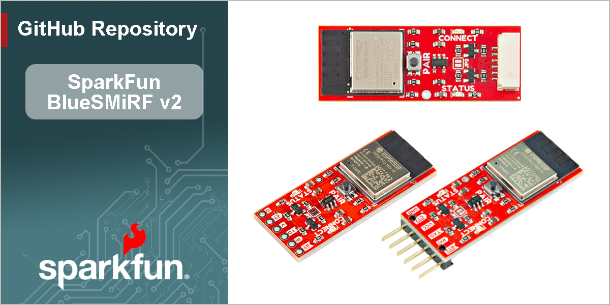

# SparkFun BlueSMiRF v2

The [SparkFun BlueSMiRF v2](https://www.sparkfun.com/sparkfun-bluesmirf-v2.html), [SparkFun BlueSMiRF v2 - Headers](https://www.sparkfun.com/sparkfun-bluesmirf-v2-headers.html), and [SparkFun BlueSMiRF v2 - JST](https://www.sparkfun.com/sparkfun-bluesmirf-v2-jst.html) are wireless Bluetooth® serial links. These boards work as a wireless serial UART pipe and are a great wireless replacement for serial cables. Simply pair, connect, and transmit serial data between your TX/RX lines! Any serial stream from 2400 to 921600 baud can be passed seamlessly between two devices.

Duplex transmissions up to 921600bps are supported. What does this mean? You can throw a book at each BlueSMiRF, which will correctly buffer, transmit, and deliver the data streams, byte perfect, to both radios.

BlueSMiRF v2 has a multitude of exciting improvements over the original. The BlueSMiRF pinout is the same as previous Bluetooth Mates and USB-to-serial converters (i.e., FTDI, CH340, etc.), making it extremely easy to hook up to many common Arduino development boards and GNSS breakout boards.  The board can be connected directly with an Arduino Pro, Pro Mini, or any board with a standard 6-pin serial connector. We broke out the pins to the 1x6 header for this version of the board. You'll need to either solder a 1x6 female header or striped wires to the PTHs before being able to connect to another device. The SparkFun BlueSMiRF v2 is perfect for short-range applications up to 100ft (33m) indoors that require easy to setup, point-to-point communication.

A BlueSMiRF can be connected to a phone or computer to view data or remote control easily. Two BlueSMiRFs can also be easily connected using the onboard PAIR button. If needed, this button can be disabled by cutting the jumper on the back of the board.

We've designed the BlueSMiRF to be remotely configured from a phone using a serial terminal app. Changing the settings, such as the baud rate, flow control, and LED mode, is easily done using the simple AT command set. Additionally, Over The Air (OTA) updates using WiFi allow easy in-field firmware updates as new features are released.

The BlueSMiRF v2 has an on-board voltage regulator to power between 3.3V and 5V. Logic level shifting circuitry is included on all pins to be 3.3V to 5V tolerant. Note that you will need an RS232 to TTL converter for higher voltages. A jumper on the top of the board is also included to bypass the voltage regulator. Two built-in LEDs indicate when the BlueSMiRF is connected and when there is serial UART traffic.

> [!NOTE]
> Bluetooth® classic (Serial Port Profile or SPP) is primarily supported. This Bluetooth protocol is supported on Android phones, most desktops, and laptops. BlueSMiRF also supports the BLE protocol, available on all Apple phones.

This repo houses the [BlueSMiRF v2 Hookup Guide](https://docs.sparkfun.com/SparkFun_BlueSMiRF-v2) and the firmware that runs on the SparkFun BlueSMiRF v2 product line including:

- [SparkFun BlueSMiRF v2 - PTH Pins](https://www.sparkfun.com/sparkfun-bluesmirf-v2.html)
- [SparkFun BlueSMiRF v2 - Male Header Pins](https://www.sparkfun.com/sparkfun-bluesmirf-v2-headers.html)
- [SparkFun BlueSMiRF v2 - JST-GH Connector](https://www.sparkfun.com/sparkfun-bluesmirf-v2-jst.html)

> [!NOTE]
> For compiled binaries of the firmware, please see [SparkFun BlueSMiRF ESP32 Firmware Binaries](https://github.com/sparkfun/SparkFun_BlueSMiRF-v2_Binaries).

## Documentation

- **[Hookup Guide](http://docs.sparkfun.com/SparkFun_BlueSMiRF-v2/)** - Hookup guide for the BlueSMiRF v2 hosted by GitHub pages. 
    
  *Need to download or print our hookup guide?*

  - [Print *(Print to PDF)* from Single-Page View](http://docs.sparkfun.com/SparkFun_BlueSMiRF-v2/print_view)

- **[Firmware Binaries](https://github.com/sparkfun/SparkFun_BlueSMiRF-v2_Binaries)** - Compiled binaries of the firmware on the BlueSMiRF v2

## Repository

### Contents

- **[/.github/workflows](/.github/workflows)** - YAML files used for GitHub Actions; compiles firmware binaries and deploys product documentation
- **[/docs](/docs/)** - Online documentation files
  - [/assets](/docs/assets/) - Assets files
    - [/3d_model](/docs/assets/3d_model/) - 3D models for the board
    - [/board_files](/docs/assets/board_files/) - Design files for the board
      - [KiCad Design Files](/docs/assets/board_files/kicad_files.zip) (.zip)
      - [Schematics](/docs/assets/board_files/schematics.pdf) (.pdf)
      - [Dimensions](/docs/assets/board_files/dimensions.pdf) (.pdf)
    - [/component_documentation](/docs/assets/component_documentation/) - Datasheets for hardware components
    - [/img/hookup_guide](/docs/assets/img/hookup_guide/) - Images for hookup guide documentation - Hookup guide images for the board
- **[/Firmware](/Firmware/)** - Source code for SparkFun BlueSMiRF firmware as well as various feature unit tests
- /Hardware - Hardware design files (.brd, .sch)
  - /Production - Production files

### Branch Structure
This repository has two long-term branches: `main` and `release_candidate`.

With respect to the firmware, `main` is a branch where only changes that are appropriate for all users are applied. Thus, following `main` means updating to normal releases, and perhaps bugfixes to those releases.

In contrast, `release_candidate` is where new code is added as it is developed.

The documentation source code is in `docs/` on `main`.  It is built automatically on push and stored in the branch `gh-pages`, from which it is served at the above URL. Documentation changes are pushed directly to main.

## Releases

### Firmware Releases
A release is made by merging `release_candidate` back to `main`, and then applying a tag to that commit on `main`.

A pre-release is often created using the latest stable release candidate. These binaries will have extra debug statements turned on that will not be present in a formal release, but should not affect the behavior of the firmware.

> [!NOTE]
> **Firmware Updates:** Because it's much easier to use, we recommend the OTA firmware update process. If that fails for some reason, you can upload the firmware directly. For more information, check out the tutorial under the section [Manually Reprogramming](https://docs.sparkfun.com/SparkFun_BlueSMiRF-v2/firmware-overview/#manually-reprogramming/).

### Product Variants

- [WRL-24113](https://www.sparkfun.com/sparkfun-bluesmirf-v2.html) - Initial release, PTH pads variant
- [WRL-23287](https://www.sparkfun.com/sparkfun-bluesmirf-v2-headers.html) - Initial release, male header pins variant
- [WRL-30414](https://www.sparkfun.com/sparkfun-bluesmirf-v2-jst.html) - Initial release, JST connector variant

### Version History

- [v10](https://github.com/sparkfun/SparkFun_BlueSMiRF-v2/releases/tag/v10) - Initial Release; for latest JST variant and docs landing page

## License Information
This product is ***open source***!  Please feel free to [contribute](https://docs.sparkfun.com/SparkFun_BlueSMiRF-v2/github/contribute/) to both the firmware and documentation.

Various bits of the code have different licenses applied. Anything SparkFun wrote is beerware; if you see me (or any other SparkFun employee) at the local, and you've found our code helpful, please buy us a round!

Please use, reuse, and modify these files as you see fit. Please maintain attribution to SparkFun Electronics and release anything derivative under the same license.

Distributed as-is; no warranty is given.

- Your friends at SparkFun.
