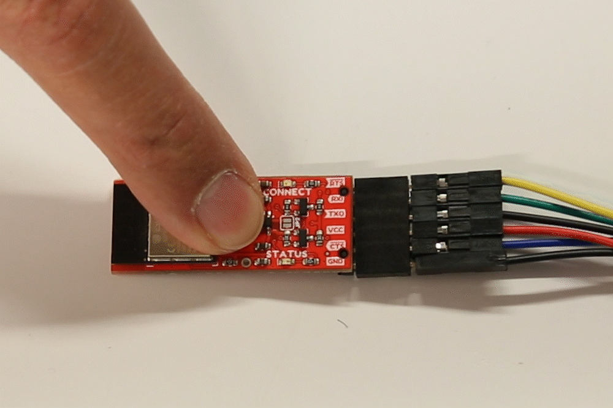

# Button Operation
The ++"PAIR"++ button on the BlueSMiRF v2 allows the device to enter a few different states.

- [Pairing Mode](#pairing-mode)
- [Discoverable Mode](#discoverable-mode)
- [Factory Reset Mode](#factory-reset-mode)
- [Bootloader Mode](#bootloader-mode)

## Serial Link
In its default configuration, users can simply scan for and connect to the BlueSMiRF v2, from their phone or a laptop using a Bluetooth connection. However, for a serial bridge between two BlueSMiRF v2 boards, one board needs to be in [**discoverable** mode](#discoverable-mode), before the other device enters [**pairing** mode](#pairing-mode) and creates its connection.

1. **Device 1:** Hold its ++"PAIR"++ button held for 4 to 8 seconds then released.
1. **Device 1:** Enters [**pairing** mode](#pairing-mode) and will scan for any devices in [**discoverable** mode](#discoverable-mode).
1. **Device 1:** When **Device 1** fails to discover any available devices, it will enter [**discoverable** mode](#discoverable-mode) and become available for pairing.
	- **Device 1** will broadcast the name **`BlueSMiRF-Pairing`** and wait for an incoming connection.
1. **Device 2:** Hold its ++"PAIR"++ button held for 4 to 8 seconds, then released.
1. **Device 2:** Will then enter [**pairing** mode](#pairing-mode) and scan for any compatible devices to pair with.
	- The scan should find that **Device 1** is in [**discoverable** mode](#discoverable-mode) broadcasting the **`BlueSMiRF-Pairing`** name.
1. **Device 2:** Connects to **Device 1**
	- **Device 2** stores the MAC address of **Device 1**
	- Whenever **Device 2** boots up, it will always try to connect to the stored the MAC address *(i.e. **Device 1**)*.
1. **Device 1:** Remains agnostic of any connections or pairing; no MAC address has been stored on it.
	- When **Device 1** boots, it will not attempt to connect to any devices.

### Pairing Mode
**Pairing** mode is used to scan and connect to other BlueSMiRF v2 devices in [**discoverable** mode](#discoverable-mode).

<figure markdown>
[{ width="600" }](./assets/img/hookup_guide/button-pair_mode.gif "Click to enlarge")
<figcaption markdown>GIF Setting BlueSMiRF v2 in Pairing Mode</figcaption>
</figure>

To enter **pairing** mode:

1. Hold the ++"PAIR"++ button down
1. Wait *(~4-8 seconds)* until the `Status` and `Connect` LEDs to slowly blink back and forth
1. Release the ++"PAIR"++ button

Once a BlueSMiRF has entered Pairing Mode, it will scan for other compatible BlueSMiRF devices.

If a second device enters Pairing Mode, it will scan for other compatible BlueSMiRF devices broadcasting the name (you guessed it) '**BlueSMiRF-Pairing**'. If a device is detected, the second device will connect to the first device, store the MAC address of the first device, and attempt to connect to it at every future power on. The first device will not be aware of or connect to another device at power on.

If no other compatible device is found after a few seconds, the BlueSMiRF will enter [**Discoverable** mode](#discoverable-mode).

### Discoverable Mode

If no other compatible device is found after a few seconds, the BlueSMiRF will enter **Discoverable** mode. The device will broadcast the name '**BlueSMiRF-Pairing**' and wait for an incoming connection.

To enter **discoverable** mode:

1. With no other devices in **discoverable** mode, hold the ++"PAIR"++ button down
1. Wait *(~4-8 seconds)* until the `Status` and `Connect` LEDs to slowly blink back and forth
1. Release the ++"PAIR"++ button
1. The BlueSMiRF v2 will enter pairing mode scanned for available devices it can connect to
1. After a few seconds, if it has failed to connect with another device, the board will enter **Discoverable** mode
	- In this mode, the `Connect` LED will slowly blink

## Factory Reset Mode
Holding the ++"PAIR"++ button for **more than 8 seconds** will cause the **Status** and **Connect** LEDs to quickly blink back and forth. If the ++"PAIR"++ button is released at this time, the device will enter Factory Reset mode.

<figure markdown>
[{ width="600" }](./assets/img/hookup_guide/button-factory_reset.gif "Click to enlarge")
<figcaption markdown>GIF Factory Reset</figcaption>
</figure>

After a Factory Reset, all settings are reset to default and/or erased in the following way:

- The baud rate is set to **115200** bps.
- The escape character is set to '`$`' and a count of 3.
- The WiFi **SSID** and **password** are erased.
- Flow control is disabled.
- All the other system settings are returned to default.

## Bootloader Mode
Hold down the ++"PAIR"++ button when the BlueSMiRF v2 is not powered. Applying power will set the microcontroller to bootloader mode. The STATUS LED will be dim indicating that we are in Bootloader Mode. After uploading the firmware binaries to the ESP32, you will need to cycle power to the device as this does not automatically exit the bootloader mode.

<figure markdown>
[{ width="600" }](./assets/img/hookup_guide/button-bootloader_mode.gif "Click to enlarge")
<figcaption markdown>GIF Setting the BlueSMiRF in Bootloader Mode</figcaption>
</figure>

!!! note
	As stated in the [hardware assembly](hardware-assembly.md#usb-to-serial-converter-to-BlueSMiRF-v2) when connecting a USB-to-serial converter, you will need to manually wire the TX-to-RX and RX-to-TX to a USB-to-serial converter with jumper wires.
