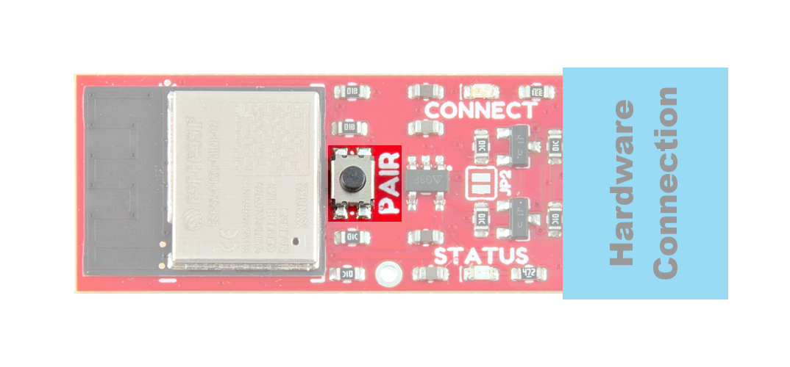
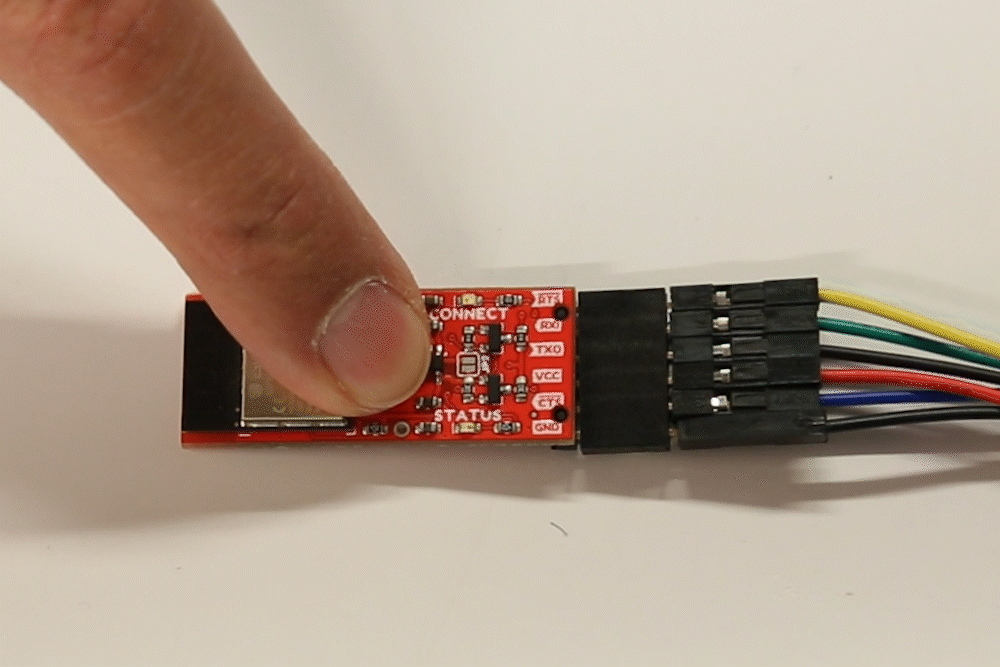

<figure markdown>
[{ width="600" }](./assets/img/hookup_guide/button.png "Click to enlarge")
<figcaption markdown>++"PAIR"++ Button on the BlueSMiRF v2.</figcaption>
</figure>

The ++"PAIR"++ button on the BlueSMiRF v2 is used to enter a few different states:

- [Discoverable Mode](device-operation.md#discoverable-mode)
	- A default state, where the device is ready to be paired with a Bluetooth device.
- [BlueSMiRF Pairing Mode](device-operation.md#bluesmirf-pairing-mode)
	- Used to pair the BlueSMiRF v2 with another BlueSMiRF v2 in the *(default)* **discoverable mode**.
- [Bootloader Mode](device-operation.md#bootloader-mode)
	- Used to manually update the firmware through the [UART interface](hardware-overview.md#uart-interface).
- [Factory Reset](device-operation.md#factory-reset)
	- Forces the BlueSMiRF v2 to return to its original factory settings. Then, it returns to the *(default)* **discoverable mode**.

## Create a Serial Link
In its default configuration, users can simply scan for and connect to the BlueSMiRF v2, from their phone or a laptop using a Bluetooth connection. However, for a serial bridge between two BlueSMiRF v2 boards, one board needs to be in [**discoverable mode**](device-operation.md#discoverable-mode), before the other device enters [**pairing mode**](device-operation.md#bluesmirf-pairing-mode) and creates their connection.

1. **Device 1:** By default, the device be in [**discoverable mode**](device-operation.md#discoverable-mode) and be available for pairing.
	- **Device 1** will broadcast the name **`BlueSMiRF-Pairing`** and wait for an incoming connection.
1. **Device 2:** Hold the ++"PAIR"++ button for 4 to 8 seconds, then release.
1. **Device 2:** Will then enter [**pairing mode**](device-operation.md#bluesmirf-pairing-mode) and scan for any compatible devices to pair with.
	- The scan should find that **Device 1** is in [**discoverable mode**](device-operation.md#discoverable-mode) broadcasting the **`BlueSMiRF-Pairing`** name.
1. **Device 2:** Connects to **Device 1**
	- **Device 2** stores the MAC address of **Device 1**
	- Whenever **Device 2** boots up, it will always try to connect to the stored the MAC address *(i.e. **Device 1**)*.
1. **Device 1:** Remains agnostic of any connections or pairing; no MAC address has been stored on it.
	- When **Device 1** boots, it will not attempt to connect to any devices.

!!! note
	The BlueSMiRF that was detected (**Device 1**), does not store the MAC address of the pairing BlueSMiRF (**Device 2**). Upon restart, the BlueSMiRF (**Device 1**) will return to the *(default)* **discoverable mode**.

### Discoverable Mode
A default state, where the device will broadcast the name **`BlueSMiRF-Pairing`**, blink the `Connect` LED slowly, and wait for an incoming connection. 

To enter **discoverable mode**:

1. With no other BlueSMiRF devices in **discoverable mode**, hold the ++"PAIR"++ button down
1. Wait *(~4-8 seconds)* until the `Status` and `Connect` LEDs to slowly blink back and forth
1. Release the ++"PAIR"++ button
1. The BlueSMiRF v2 will enter pairing mode and scan for available devices it can connect to
1. After a few seconds, if it has failed to connect with another device, the board will return to its **discoverable mode**
	- In this mode, the `Connect` LED will slowly blink

!!! note
	When the BlueSMiRF's connection is paired by another device, it does not store the MAC address of the connecting device; nor will it attempt to restore that connection upon restart.

### BlueSMiRF Pairing Mode
**Pairing mode** is used to scan and connect to other BlueSMiRF v2 devices in [**discoverable mode**](device-operation.md#discoverable-mode).

<figure markdown>
[{ width="600" }](./assets/img/hookup_guide/button-pair_mode.gif "Click to enlarge")
<figcaption markdown>GIF Setting BlueSMiRF v2 in Pairing Mode</figcaption>
</figure>

To enter **pairing mode**:

1. Hold the ++"PAIR"++ button down
1. Wait *(~4-8 seconds)* until the `Status` and `Connect` LEDs to slowly blink back and forth
1. Release the ++"PAIR"++ button

Once a BlueSMiRF has entered pairing mode, it will scan for other compatible BlueSMiRF devices broadcasting the **`BlueSMiRF-Pairing`** name. If a device is detected, it will connect to the device and store the MAC address of the located device so that it can reconnect to the same device in the future. Otherwise, if no device is found after a few seconds, the BlueSMiRF will return to its [**discoverable mode**](device-operation.md#discoverable-mode).

## Bootloader Mode
Hold down the ++"PAIR"++ button while the BlueSMiRF v2 is not powered. Applying power will set the microcontroller to **bootloader mode**; the `STATUS` LED should also be dimmed. After uploading the firmware binaries to the ESP32, you will need to cycle power to the device, as it does not automatically hard reset.

<figure markdown>
[{ width="600" }](./assets/img/hookup_guide/button-bootloader_mode.gif "Click to enlarge")
<figcaption markdown>GIF Setting the BlueSMiRF in Bootloader Mode</figcaption>
</figure>

!!! tip
	To automatically enable a hard reset, users can connect the `DTR` pin of USB-to-serial converter to the `RST` PTH pad of the BlueSMiRF with a [IC Hook with Pigtail](https://www.sparkfun.com/ic-hook-with-pigtail.html).

## Factory Reset
Holding the ++"PAIR"++ button for **more than 8 seconds** will cause the **Status** and **Connect** LEDs to quickly blink back and forth. If the ++"PAIR"++ button is released at this time, the [device settings](device-configuration.md) will be restored to their factory defaults.

<figure markdown>
[{ width="600" }](./assets/img/hookup_guide/button-factory_reset.gif "Click to enlarge")
<figcaption markdown>GIF Factory Reset</figcaption>
</figure>
