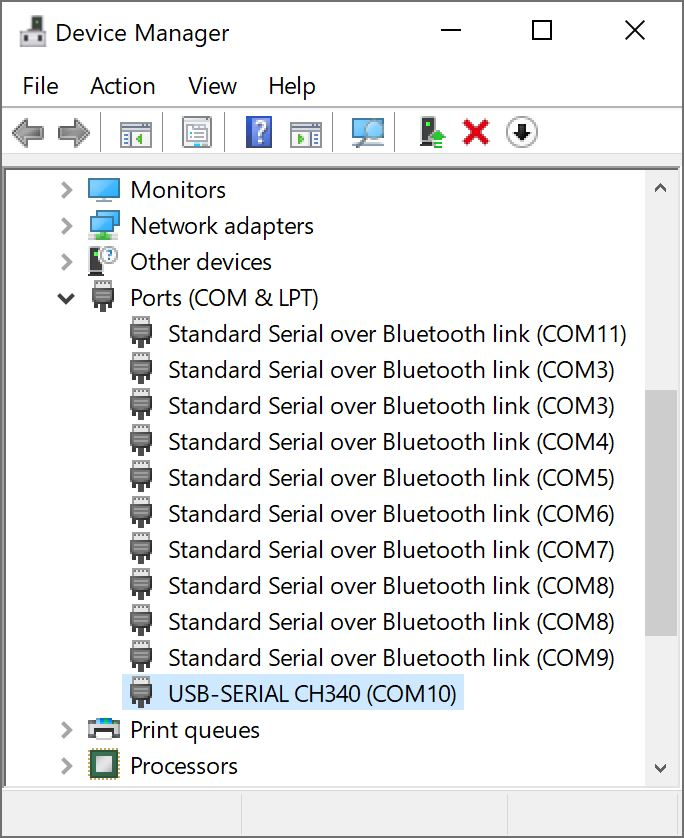
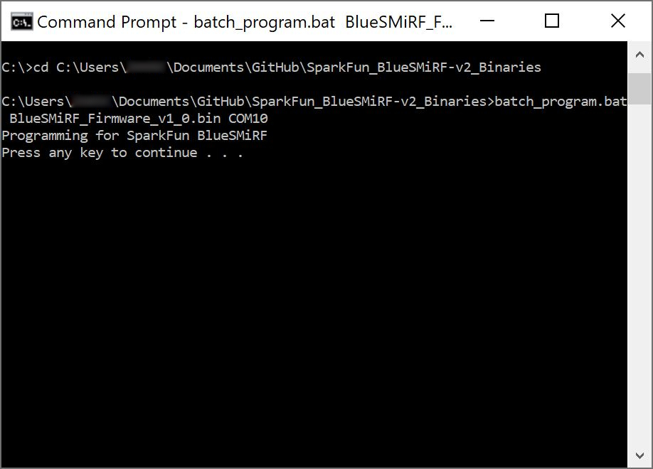
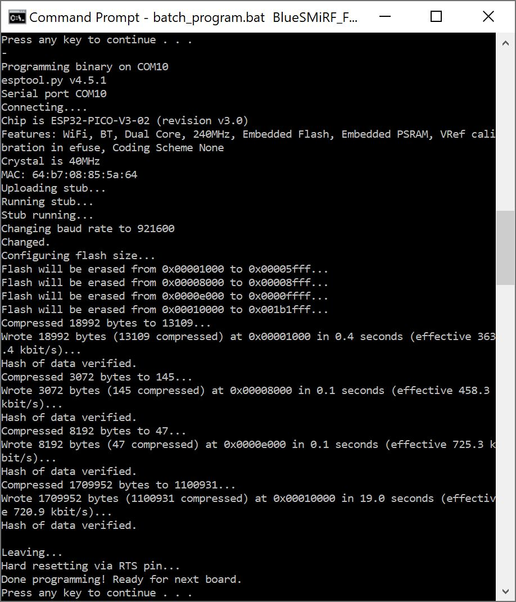

The BlueSMiRF v2 comes pre-programmed with the latest version of our [open-source firmware](https://github.com/sparkfun/SparkFun_BlueSMiRF-v2/tree/main/Firmware). However, users are free to modify the firmware and/or reprogram their board for their purposes.

Our firmware provides short-range, point-to-point communication; allowing serial UART data to be transmitted between two Bluetooth devices. It includes support for both the SPP and BLE protocols and features a massive >10kB buffer for each RX and TX channel to compensate for transmission delays. The firmware also offers a set of [AT-commands to configure the BlueSMiRF v2's settings](device-configuration.md#at-commands): including the baud rate, flow control, LED mode, and Over-The-Air (OTA) updates over a 2.4GHz WiFi network to name a few.


- Serial Bluetooth® Point-to-Point Communication
- Bluetooth Protocols Supported
	- Serial Port Profile (SPP)
	- Bluetooth Low Energy (BLE)
-	Firmware Over-the-Air (OTA) Updates via 2.4GHz WiFi


!!! abstract "Bluetooth Protocols"
	While Bluetooth Classic (Serial Port Profile or "SPP") is the primary communication protocol, which makes it highly compatible with Android devices and most computers, the BlueSMiRF v2 also supports Bluetooth Low Energy (BLE) protocol for connecting with Apple devices and other low-power devices.


## Dependencies
For users looking to modify the firmware for their own use case, the following dependencies must be installed in the Arduino IDE:


- Arduino Core: [esp32](https://github.com/espressif/arduino-esp32) v2.0.11
	- Board Manager URL:
		```
		https://raw.githubusercontent.com/espressif/arduino-esp32/gh-pages/package_esp32_index.json
		```
- Libraries:
	- [Bluetooth Serial](https://github.com/espressif/arduino-esp32/tree/master/libraries/BluetoothSerial): ESP32 Arduino core *(built-in)*
	- [ESP32-OTA-Pull](https://github.com/mikalhart/ESP32-OTA-Pull): v1.0.0
	- [ESP32_BleSerial](https://github.com/avinabmalla/ESP32_BleSerial): v1.0.4
	- [JC_Button](https://github.com/JChristensen/JC_Button): v2.1.2


!!! info
	For documentation on the Bluetooth Serial library that is built into the ESP32 Arduino core, please refer to [Espressif's API guide](https://docs.espressif.com/projects/arduino-esp32/en/latest/api/bluetooth.html).


## Board Settings
To upload the firmware, users will need to compile and upload the firmware in the Arduino IDE with the following board settings:

- Board: ESP32 Dev Module
- Flash Size: 8MB
- Partition Scheme:
	- Default: Use custom partition file named `BlueSMiRF_Partitions.csv`
		- Partitions:
			- app0 (0x3C0000): 3.9MB
			- app1 (0x3C0000): 3.9MB
			- spiffs (0x1000): 4096
	- Alternative: Built-in `Minimal SPIFFs (1.9MB APP with OTA)`
- PSRAM: Enabled


!!! tip "Bootloader Mode"
	Users can manually force the ESP32 into the <a href="https://docs.espressif.com/projects/esptool/en/latest/esp32/advanced-topics/boot-mode-selection.html#select-bootloader-mode">serial bootloader mode</a> with the ++"PAIR"++ button, to upload new firmware to the BlueSMiRF v2. Please, refer to the [**++"PAIR"++ Button** section](hardware_overview.md#pair-button) below for more information.


## Update Methods
From time to time, SparkFun will release new firmware for the BlueSMiRF v2 product line to add and improve functionality. For most users, firmware can be upgraded over a 2.4GHz WiFi network using the [OTA method](firmware-update.md#over-the-air-ota). Users can also update the firmware by manually reprogramming the device with the new firmware.


### Over-The-Air (OTA)
Because it's much easier to use, we recommend this method. However, it does require an internet connection through your local WiFi network. Once the `AT-WiFiSSID` and `AT-WiFiPassword` settings have been entered for your local WiFi network, the `ATC` command can be issued to check for new firmware. If new firmware is available, send the `ATU` command to begin an update.


1. Enter command mode:
	- UART Interface: `$$$`
	- Bluetooth Serial Link: `+++` *(remote access)*
1. Configure the `AT-WiFiSSID` and `AT-WiFiPassword` parameters for your local WiFi network
1. Save the new settings (`ATW`)
1. Issue the `ATC` command to check for new firmware.
1. If new firmware is available, send the `ATU` command to begin an update.
1. The device will restart after the update process is complete


??? example
	Below, is an example of this method using the UART interface. In the example, the WiFi network's SSID is `sparkfun-guest` and its password is `sparkfun6333`. The highlighted lines represent the commands that were sent.

	!!! terminal
		``` bash hl_lines="3 5 8 11 14 25"
		BlueSMiRF-v1.0

		$$$
		OK
		at-wifissid=sparkfun-guest
		AT-WIFISSID=sparkfun-guest
		OK
		at-wifipassword=sparkfun6333
		AT-WIFIPASSWORD=sparkfun6333
		OK
		atw
		ATW
		OK
		atc
		ATC
		Connecting to sparkfun-guest...
		Connected!
		Checking to see if an update is available from https://raw.githubusercontent.com/sparkfun/SparkFun_BlueSMiRF-v2_Binaries/main/BlueSMiRF-Firmware.json

		Current firmware version: v1.0

		New firmware version available: 1.1

		OK
		atu
		ATU
		Connecting to sparkfun-guest...
		Connected!
		Getting new firmware
		Installing new firmware

		[ 0%

		[ 1%

		[ 2%

		.
		.
		.

		[=================== 99%

		[==================== 100%
		]
		BlueSMiRF-v1.1

		```


### Manually Reprogramming
If for some reason the OTA method can't be used, users can also manually reprogram the microcontroller on the BlueSMiRF v2.


1. **Download the Firmware:** Download and unzip the contents of the [SparkFun_BlueSMiRF-v2_Binaries GitHub repository](https://github.com/sparkfun/SparkFun_BlueSMiRF-v2_Binaries).
	<article style="text-align: center;" markdown>
	[Download BlueSMiRF v2 Binaries GitHub Repo (ZIP)](https://github.com/sparkfun/SparkFun_BlueSMiRF-v2_Binaries/archive/main.zip){ .md-button .md-button--primary }
	</article>
1. **Connect Hardware:** Wire the BlueSMiRF v2 to a USB-to-Serial converter, ensuring the TX and RX connections are crossed over. To automatically trigger a reset, connect the converter's `DTR` pin to the BlueSMiRF v2's `RST` PTH pad.
	<article style="text-align: center;" markdown>

	| USB-to-Serial Converter | BlueSMiRF v2 |
	| :-: | :-: |
	| DTR | RST *(PTH Pad)* |
	| RXI | TXO |
	| RXI | TXO |
	| 3V3 | VCC |
	| GND | GND |

	</article>

1. **Identify the Port:** Find your USB-to-Serial COM port using Windows Device Manager or your macOS/Linux terminal (e.g., `/dev/ttyUSB0`).

	<figure markdown>
	[{ width="300" }](./assets/img/hookup_guide/firmware-device_manager.jpg "Click to enlarge")
	<figcaption markdown>CH340 is on COM10 as shown in Device Manager</figcaption>
	</figure>

1. **Upload the Firmware:** Open a command prompt or terminal, navigate to the unzipped firmware directory, and execute the appropriate flash command for your OS:
    * **Windows:** Run the following command in the command prompt
		```
		.\batch_program.bat .\<firmware_name.bin> <COM_PORT>
		```
    * **macOS/Linux:** Run the following command in the terminal
		```
		./batch_program.sh ./<firmware_name.bin> <COM_PORT>
		```

	??? note "Script Details"
		These scripts basically run the following command in a loop:

		```sh
		<ESPTOOL_EXECUTABLE> --chip esp32 --port <COM_PORT> --baud 921600 --before default-reset --after hard-reset write-flash -z --flash-mode dio --flash-freq 80m --flash-size 8MB 0x1000 bins/bootloader.bin 0x8000 bins/partitions.bin 0xe000 bins/boot_app0.bin 0x10000 <BINARY_FILE>
		```

		Where the the following are variables are replaced with:
		
		- Windows:
			- **<ESPTOOL_EXECUTABLE\>:** `esptool.exe`
			- **<COM_PORT\>:** `COM#` *(i.e. `COM4`)*
		- Linux/MacOS:
			- **<ESPTOOL_EXECUTABLE\>:** `esptool`
			- **<COM_PORT\>:** `/dev/tty*` *(i.e. `/dev/ttyUSB0`)*
		- **<BINARY_FILE\>:** `BlueSMiRF_Firmware_vx_x.bin`


	!!! tip
		Some users have reported issues, where the `921600` baud rate does not work. If you encounter this problem, reduce the baud rate to `115200`.

1.	**Start the Programming Process:** When prompted, press a keyboard key to start the programming process.
	<figure markdown>
	[{ width="600" }](./assets/img/hookup_guide/firmware-execute_batch.jpg "Click to enlarge")
	<figcaption markdown>`batch_program.bat` running `esptool`</figcaption>
	</figure>

1. **Enter Bootloader Mode:** When the `Connecting.......` prompt pops up, press and hold the ++"PAIR"++ button.

	!!! tip
		Bootloader mode is active when the `STATUS` LED is dimly lit and the `CONNECT` LED is off.

1. **Wait for Process to Complete**
1. **Reboot:** Power cycle the BlueSMiRF by disconnecting and reconnecting power to exit bootloader mode and run the new firmware.

	!!! tip
		If you previously connected the `DTR` pin of the USB-to-Serial converter to the `RST` PTH pad on the BlueSMiRF v2, it isn't necessary to power cycle the board.

1. **Programming Complete:**: Wait for the following prompt `Done programming! Ready for next board.`

	<figure markdown>
	[{ width="600" }](./assets/img/hookup_guide/firmware-upload_complete.jpg "Click to enlarge")
	<figcaption markdown>Successfully Programmed BlueSMiRF v2 - ESP32</figcaption>
	</figure>

1. **Next:**
	- To exit, click ++ctrl++ + ++c++ to exit the batch file. You can also just close the window.
	- Otherwise, connect another BlueSMiRF v2 to the USB-to-serial converter and click a keyboard key to program the next board


## Changelog

--8<-- "./Firmware/changelog.md:2:"
