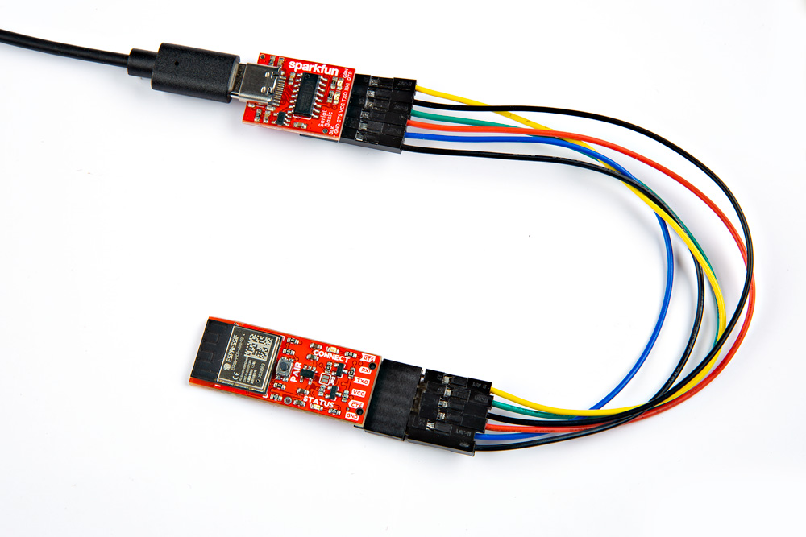
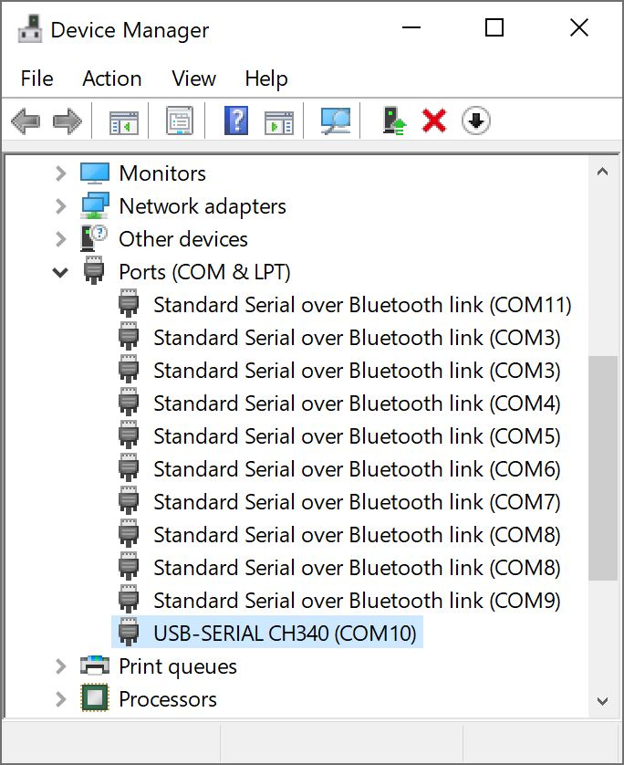
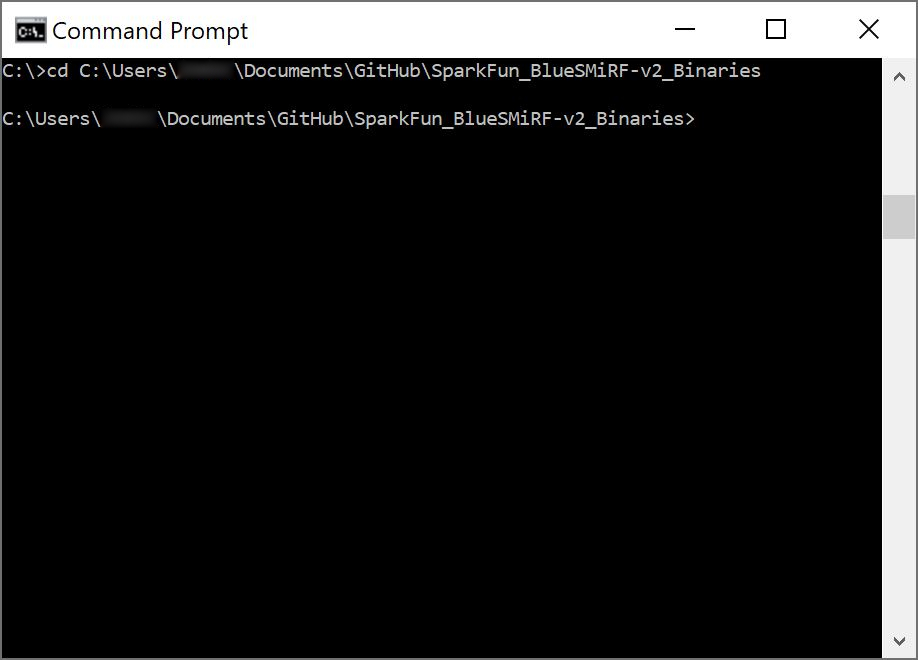
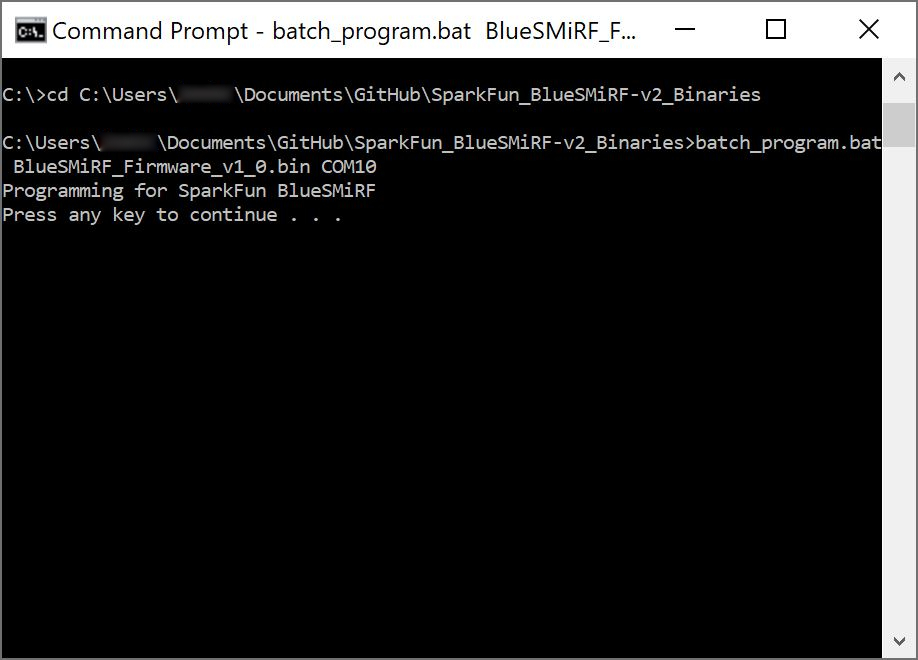
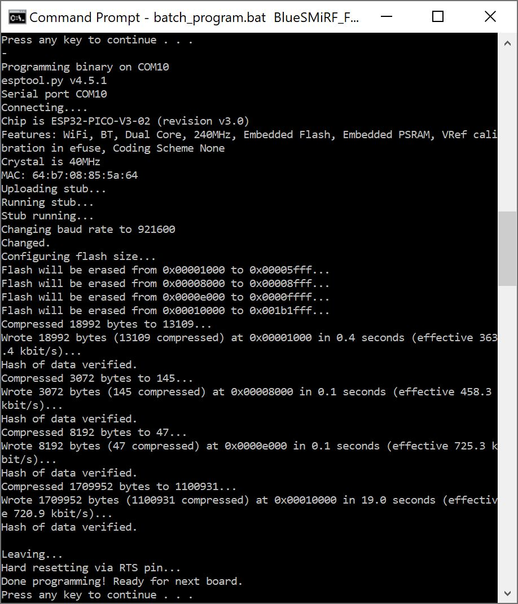

From time to time, SparkFun will release new firmware for the BlueSMiRF v2 product line to add and improve functionality. For most users, firmware can be upgraded over a 2.4GHz WiFi network using the [OTA method](firmware-update.md#over-the-air-ota). Users can also update the firmware by manually reprogramming the device with the new firmware.


## Over-The-Air (OTA)
Because it's much easier to use, we recommend this method. However, it does require an internet connection through your local WiFi network. Once the `AT-WiFiSSID` and `AT-WiFiPassword` settings have been entered for your local WiFi network, the `ATC` command can be issued to check for new firmware. If new firmware is available, send the `ATU` command to begin an update.


1. Enter command mode:
	- UART Interface: `$$$`
	- Bluetooth Serial Link: `+++` *(remote access)*
1. Configure the `AT-WiFiSSID` and `AT-WiFiPassword` parameters for your local WiFi network
1. Save the new settings (`ATW`)
1. Issue the `ATC` command to check for new firmware.
1. If new firmware is available, send the `ATU` command to begin an update.
1. The device will restart after the update process is complete


??? example
	Below, is an example of this method using the UART interface. In the example, the WiFi network's SSID is `sparkfun-guest` and its password is `sparkfun6333`. The highlighted lines represent the commands that were sent.

	!!! terminal
		``` bash hl_lines="3 5 8 11 14 25"
		BlueSMiRF-v1.0

		$$$
		OK
		at-wifissid=sparkfun-guest
		AT-WIFISSID=sparkfun-guest
		OK
		at-wifipassword=sparkfun6333
		AT-WIFIPASSWORD=sparkfun6333
		OK
		atw
		ATW
		OK
		atc
		ATC
		Connecting to sparkfun-guest...
		Connected!
		Checking to see if an update is available from https://raw.githubusercontent.com/sparkfun/SparkFun_BlueSMiRF-v2_Binaries/main/BlueSMiRF-Firmware.json

		Current firmware version: v1.0

		New firmware version available: 1.1

		OK
		atu
		ATU
		Connecting to sparkfun-guest...
		Connected!
		Getting new firmware
		Installing new firmware

		[ 0%

		[ 1%

		[ 2%

		.
		.
		.

		[=================== 99%

		[==================== 100%
		]
		BlueSMiRF-v1.1

		```


## Manually Reprogram the BlueSMiRF
If for some reason the OTA method can't be used, users can also manually reprogram the microcontroller on the BlueSMiRF v2.


1. **Download the Firmware:** Download and unzip the contents of the [SparkFun_BlueSMiRF-v2_Binaries GitHub repository](https://github.com/sparkfun/SparkFun_BlueSMiRF-v2_Binaries).
	<article style="text-align: center;" markdown>
	[Download BlueSMiRF v2 Binaries GitHub Repo (ZIP)](https://github.com/sparkfun/SparkFun_BlueSMiRF-v2_Binaries/archive/main.zip){ .md-button .md-button--primary }
	</article>
1. **Connect Hardware:** Wire the BlueSMiRF v2 to a USB-to-Serial converter, ensuring the TX and RX connections are crossed over. To automatically trigger a reset, connect the converter's `DTR` pin to the BlueSMiRF v2's `RST` PTH pad.
	<article style="text-align: center;" markdown>

	| USB-to-Serial Converter | BlueSMiRF v2 |
	| :-: | :-: |
	| DTR | RST *(PTH Pad)* |
	| RXI | TXO |
	| RXI | TXO |
	| 3V3 | VCC |
	| GND | GND |

	</article>

1. **Identify the Port:** Find your USB-to-Serial COM port using Windows Device Manager or your macOS/Linux terminal (e.g., `/dev/ttyUSB0`).
1. **Upload the Firmware:** Open a command prompt or terminal, navigate to the unzipped firmware directory, and execute the appropriate flash command for your OS:
    * **Windows:** Run `batch_program.bat <firmware_name.bin> <COM_PORT>`.
    * **macOS/Linux:** Run `batch_program.bat <firmware_name.bin> <COM_PORT>`.
    * *Note:* If the upload fails at the `921600` baud rate, decrease it to `115200`.
1. **Enter Bootloader Mode:** Hold the ++"PAIR"++ button while applying power to the device. Bootloader mode is active when the `STATUS` LED is dimly lit and the `CONNECT` LED is off.
1. **Reboot:** Power cycle the BlueSMiRF by disconnecting and reconnecting power to exit bootloader mode and run the new firmware.


## Manually Reprogram the BlueSMiRF
If for some reason the OTA method can't be used, users can also manually reprogram the microcontroller on the BlueSMiRF v2.

<figure markdown>
[{ width="600" }](./assets/img/hookup_guide/assembly-smd-uart_adapter-alt.jpg "Click to enlarge")
<figcaption markdown>USB-to-Serial Converter (CH340) to BlueSMiRF v2 Header with an Additional Stackable Header</figcaption>
</figure>


#### Connect
Identify the COM port the USB-to-Serial device enumerated at. The easiest way to do this is to open the Device Manager under the **Ports (COM & LPT)** tree:


<figure markdown>
[{ width="300" }](./assets/img/hookup_guide/firmware-device_manager.jpg "Click to enlarge")
<figcaption markdown>CH340 is on COM10 as shown in Device Manager</figcaption>
</figure>


If the COM port is not showing, be sure the unit is turned **On**. If an unknown device is appearing, you’ll need to install drivers for your USB-to-serial device ([we'll assume that you are using the CH340](https://learn.sparkfun.com/tutorials/how-to-install-ch340-drivers/all)).


#### Upload
Open a command prompt (++win++ + ++r++ then type `cmd`). Head to the directory where you unzipped the folder. You'll need to use the `cd` commmand, paste the path where you unzipped the folder, and hit the ++enter++ key.


<figure markdown>
[{ width="600" }](./assets/img/hookup_guide/firmware-repository_directory.jpg "Click to enlarge")
<figcaption markdown>Change Path to BlueSMiRF Binaries Folder</figcaption>
</figure>


You'll then need to run the '**batch_program.bat**' along with the binary file name and COM port. Enter the following command below, where **COM4** should be replaced by the COM port you identified earlier and **BlueSMiRF_Firmware_v1_0.bin** is the firmware that you are updating to. Make sure to send an additional key to run the batch file.


```sh
batch_program.bat BlueSMiRF_Firmware_v1_0.bin COM4
```


<figure markdown>
[{ width="600" }](./assets/img/hookup_guide/firmware-execute_batch.jpg "Click to enlarge")
<figcaption markdown>`batch_program.bat` running `esptool`</figcaption>
</figure>


After about 20 seconds, you should see the following message: `Done programming! Ready for next board.`


<figure markdown>
[{ width="600" }](./assets/img/hookup_guide/firmware-upload_complete.jpg "Click to enlarge")
<figcaption markdown>Successfully Programmed BlueSMiRF v2 - ESP32</figcaption>
</figure>


The batch file runs the following commands, where `COM4` is replaced with the COM port that the BlueSMiRF product enumerated at and `BlueSMiRF_Firmware_vx_x.bin` is the firmware you would like to load.


```sh
esptool.exe --chip esp32 --port COM4 --baud 921600 --before default_reset --after hard_reset write_flash -z --flash_mode dio --flash_freq 80m --flash_size 8MB 0x1000 bins/bootloader.bin 0x8000 bins/partitions.bin 0xe000 bins/boot_app0.bin 0x10000 BlueSMiRF_Firmware_v1_0.bin
```


Open a Terminal window and run the following command, where `/dev/ttyUSB0` is replaced with the port that the USB-to-Serial board enumerated at and `BlueSMiRF_Firmware_vx_x.bin` is the firmware version you would like to upload.

```sh
py esptool.py --chip esp32 --port /dev/ttyUSB0 --baud 921600 --before default-reset --after hard-reset write-flash -z --flash-mode dio --flash-freq 80m --flash-size 8MB 0x1000 bins/bootloader.bin 0x8000 bins/partitions.bin 0xe000 bins/boot_app0.bin 0x10000 BlueSMiRF_Firmware_vx_x.bin
```


!!! note
	Some users have reported the `921600` baud rate does not work. Decrease this to `115200` as needed.


!!! tip
	Finished programming the ESP32? Type ++ctrl++ + ++c++ , ++y++ , and ++enter++ to exit the batch file. You can also close the window.


### Reboot
Upon completion, the BlueSMiRF v2 must be power cycled to exit bootloader mode. Once power cycled, the BlueSMiRF will start running the new firmware.


!!! note
	We recommend disconnecting the USB cable from the USB-to-Serial Converter or your computer's USB port.
