## General Connection
For a connection between two UART interfaces, the data and flow-control signals are cross-coupled. In addition, power must also be supplied to the BlueSMiRF v2.

| **Device 1** | `RX` | `TX` |
| :----------- | :--: | :--: |
| **Device 2** | `TX` | `RX` |
<figcaption markdown>UART data bus only</figcaption>

| **Device 1** | `RX` | `TX` | `CTS` | `RTS` |
| :----------- | :--: | :--: | :---: | :---: |
| **Device 2** | `TX` | `RX` | `RTS` | `CTS` |
<figcaption markdown>UART with flow control</figcaption>

## JST Connector
In most circumstances, users will utilize the JST connector to interface with one of our [high-precision GNSS breakout boards](https://www.sparkfun.com/gnss/gnss-boards/high-precision-gnss-boards.html) for RTK correction data. However, users can also use the JST breadboard cable to connect the BlueSMiRF v2 - JST to other boards.

<figure markdown>
[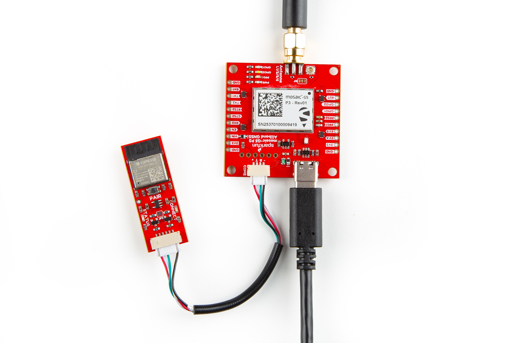{ width="400" }](./assets/img/hookup_guide/assembly-jst-gnss.jpg "Click to enlarge")
<figcaption markdown>Connecting to an All-band GNSS RTK board with a JST adapter cable.</figcaption>
</figure>

??? warning "Compatibility - JST Connections"
	The simplest way to connect the BlueSMiRF to most of our GNSS breakout boards, is with our JST adapter cables:

	- [100mm Cable](https://www.sparkfun.com/ghr-04v-s-to-ghr-06v-s-cable-100mm.html)
	- [150mm Cable](https://www.sparkfun.com/jst-ghr-04v-to-jst-ghr-06v-cable-1-25mm-pitch.html)

	Unfortunately, when we designed some of our earlier GNSS boards/products, the pin layout of the JST connection wasn't been standardized yet. Therefore, users will need to verify that the pin layout of the GNSS breakout board's JST connector is compatibile with our adapter cables.

	<article class="grid" style="place-items: center;" markdown>

	<article markdown>

	<figure markdown>
	[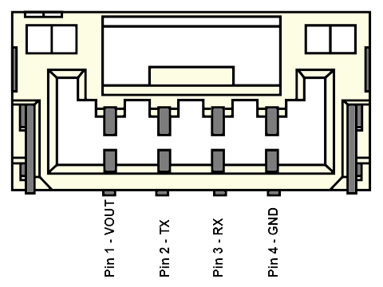{ width="250" }](./assets/img/hookup_guide/connection-jst-4.png "Click to enlarge")
	<figcaption markdown>The pin connections of a compatible JST connector</figcaption>
	</figure>

	</article>

	<article markdown>

	<figure markdown>
	[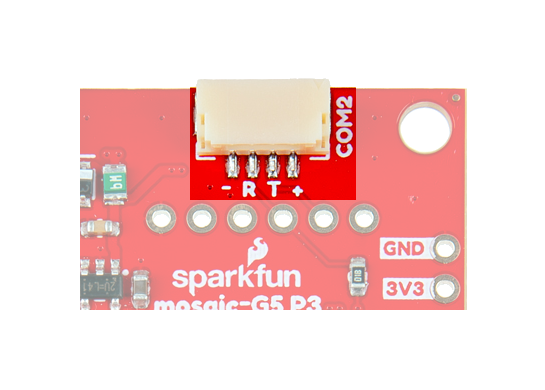{ width="250" }](./assets/img/hookup_guide/connection-jst-gnss.png "Click to enlarge")
	<figcaption markdown>The pin labels for a compatible JST connector</figcaption>
	</figure>

	</article>

	</article>

	<article style="text-align: center;" markdown>

	<table border="1" markdown>
	<tr markdown>
	<th style="vertical-align:middle;">Pin Number</th>
	<th style="text-align:center;" markdown>`1` *(Left)*</td>
	<th style="text-align:center;" markdown>`2`</td>
	<th style="text-align:center;" markdown>`3`</td>
	<th style="text-align:center;" markdown>`4` *(Right)*</td>
	</tr>
	<tr markdown>
	<th>Label</th>
	<td style="text-align:center;" markdown>`+`, `V`, etc.</td>
	<td style="text-align:center;" markdown>`T`, `TX`, etc.</td>
	<td style="text-align:center;" markdown>`R`, `RX`, etc.</td>
	<td style="text-align:center;" markdown>`-`, `G`, etc.</td>
	</tr>
	<tr markdown>
	<th style="vertical-align:middle;">Function</th>
	<td style="text-align:center; vertical-align:middle;" markdown>**Voltage Output** *3.3 to 5V*</td>
	<td style="text-align:center; vertical-align:middle;" markdown>**UART** Transmit</td>
	<td style="text-align:center; vertical-align:middle;" markdown>**UART** Receive</td>
	<td style="text-align:center; vertical-align:middle;" markdown>**Ground**</td>
	</tr>
	</table>

	</article>

<figure markdown>
[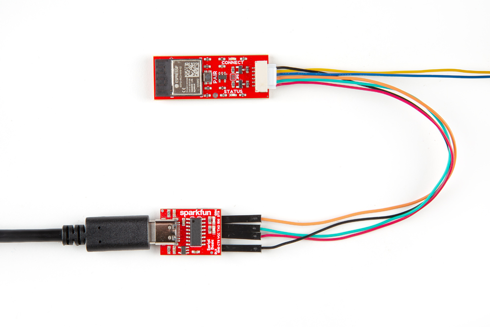{ width="400" }](./assets/img/hookup_guide/assembly-jst-ch340.jpg "Click to enlarge")
<figcaption markdown>Connecting to the Serial Basic breakout with a JST breadboard cable.</figcaption>
</figure>

??? info "Pin Layout - BlueSMiRF"

	

	

	<figure markdown>
	[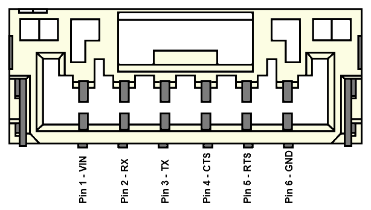{ width="330" }](./assets/img/hookup_guide/connection-jst-6.png "Click to enlarge")
	<figcaption markdown>The pin connections of the JST connector on the BlueSMiRF v2.</figcaption>
	</figure>

	

	

	<figure markdown>
	[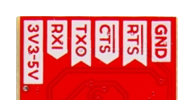{ width="330" }](./assets/img/hookup_guide/connection-jst-labels.png "Click to enlarge")
	<figcaption markdown>The labels for the JST-GH connector's pins, on the bottom of the BlueSMiRF v2.</figcaption>
	</figure>

	

	

	<article style="text-align: center;" markdown>

	<table border="1" markdown>
	<tr markdown>
	<th style="text-align:center; vertical-align:middle;" markdown>Pin Number</th>
	<th style="text-align:center;" markdown>`1` *(Left)*</th>
	<th style="text-align:center;" markdown>`2`</th>
	<th style="text-align:center;" markdown>`3`</th>
	<th style="text-align:center;" markdown>`4`</th>
	<th style="text-align:center;" markdown>`5`</th>
	<th style="text-align:center;" markdown>`6` *(Right)*</th>
	</tr>
	<tr markdown>
	<th markdown>Label</th>
	<td style="text-align:center;" markdown>`3V3-5V`</td>
	<td style="text-align:center;" markdown>`RXI`</td>
	<td style="text-align:center;" markdown>`TXO`</td>
	<td style="text-align:center;" markdown>`CTS`</td>
	<td style="text-align:center;" markdown>`RTS`</td>
	<td style="text-align:center;" markdown>`GND`</td>
	</tr>
	<tr markdown>
	<th style="vertical-align:middle;">Function</th>
	<td style="text-align:center; vertical-align:middle;" markdown>
		**Voltage Input** 
		3.3 to 5V
	</td>
	<td style="text-align:center; vertical-align:middle;" markdown>
		**UART** 
		Receive
	</td>
	<td style="text-align:center; vertical-align:middle;" markdown>
		**UART** 
		Transmit
	</td>
	<td style="text-align:center; vertical-align:middle;" markdown>
		**Flow Control** 
		*Clear-to-Send*
	</td>
	<td style="text-align:center; vertical-align:middle;" markdown>
		**Flow Control** 
		*Ready-to-Send*
	</td>
	<td style="text-align:center; vertical-align:middle;" markdown>**Ground**</td>
	</tr>
	</table>

	</article>

## Male Header Pins
The pins of the BlueSMiRF v2 - Male Header are broken out into 0.1"-spaced male header pins on the outer edges of the board. In most circumstances, users will simply connect the BlueSMiRF v2 to the female headers of another board or utilize jumper wires to make the connection.

<figure markdown>
[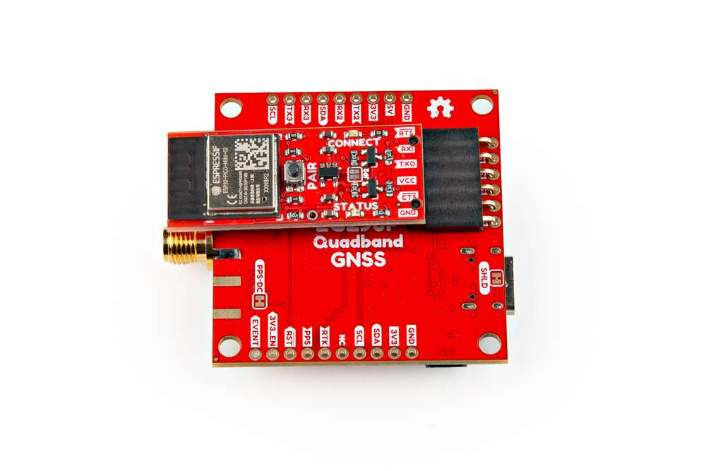{ width="400" }](./assets/img/hookup_guide/assembly-smd-gnss.jpg "Click to enlarge")
<figcaption markdown>Connecting to a header on the All-band GNSS RTK breakout board.</figcaption>
</figure>

<figure markdown>
[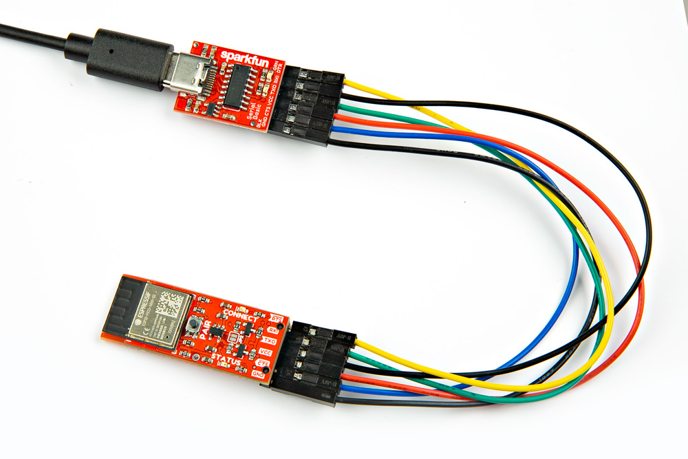{ width="400" }](./assets/img/hookup_guide/assembly-smd-uart_adapter.jpg "Click to enlarge")
<figcaption markdown>Connecting to the Serial Basic breakout with jumper wires.</figcaption>
</figure>

??? info "Pin Layout - BlueSMiRF"
	

	

	<figure markdown>
	[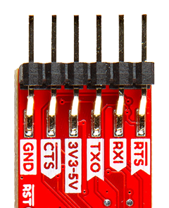{ width="330" }](./assets/img/hookup_guide/connection-smd-labels-bottom.png "Click to enlarge")
	<figcaption markdown>The labels for the header pins, on the bottom of the BlueSMiRF v2.</figcaption>
	</figure>

	

	

	<figure markdown>
	[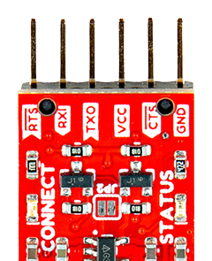{ width="330" }](./assets/img/hookup_guide/connection-smd-labels-top.png "Click to enlarge")
	<figcaption markdown>The labels for the header pins, on the top of the BlueSMiRF v2.</figcaption>
	</figure>

	

	

	<article style="text-align: center;" markdown>

	<table border="1" markdown>
	<tr markdown>
	<th style="text-align:center; vertical-align:middle;" markdown>Pin Number</th>
	<th style="text-align:center;" markdown>`1` *(Left)*</th>
	<th style="text-align:center;" markdown>`2`</th>
	<th style="text-align:center;" markdown>`3`</th>
	<th style="text-align:center;" markdown>`4`</th>
	<th style="text-align:center;" markdown>`5`</th>
	<th style="text-align:center;" markdown>`6` *(Right)*</th>
	</tr>
	<tr markdown>
	<th style="vertical-align:middle;" markdown>Label</th>
	<td style="text-align:center; vertical-align:middle;" markdown>`GND`</td>
	<td style="text-align:center; vertical-align:middle;" markdown>`CTS`</td>
	<td style="text-align:center; vertical-align:middle;" markdown>Top: `VCC` Bottom: `3V3-5V`</td>
	<td style="text-align:center; vertical-align:middle;" markdown>`TXO`</td>
	<td style="text-align:center; vertical-align:middle;" markdown>`RXI`</td>
	<td style="text-align:center; vertical-align:middle;" markdown>`RTS`</td>
	</tr>
	<tr markdown>
	<th style="vertical-align:middle;">Function</th>
	<td style="text-align:center; vertical-align:middle;" markdown>**Ground**</td>
	<td style="text-align:center; vertical-align:middle;" markdown>**Flow Control** *Clear-to-Send*</td>
	<td style="text-align:center; vertical-align:middle;" markdown>**Voltage Input** 3.3 to 5V</td>
	<td style="text-align:center; vertical-align:middle;" markdown>**UART** Transmit</td>
	<td style="text-align:center; vertical-align:middle;" markdown>**UART** Receive</td>
	<td style="text-align:center; vertical-align:middle;" markdown>**Flow Control** *Ready-to-Send*</td>
	</tr>
	</table>

	</article>

## PTH Pads
The [PTH](https://en.wikipedia.org/wiki/Through-hole_technology "Plated Through Holes") pads of the BlueSMiRF v2 - PTH Pins are broken out into 0.1"-spaced holes on the outer edges of the board.

??? note "New to soldering?"
	If you have never soldered before or need a quick refresher, check out our [How to Solder: Through-Hole Soldering](https://learn.sparkfun.com/tutorials/how-to-solder-through-hole-soldering) guide.

	

	-   <a href="https://learn.sparkfun.com/tutorials/5">
		<figure markdown>
		
		</figure>

		---

		**How to Solder: Through-Hole Soldering**</a>

	

### Headers
When selecting headers, be sure you are aware of the functionality you require.

<figure markdown>
[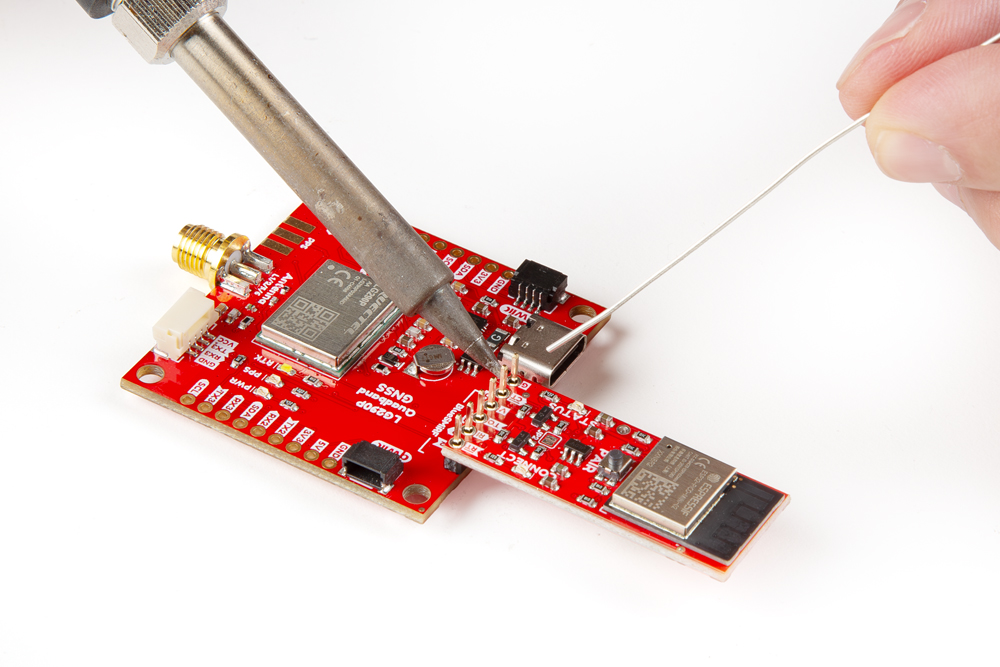{ width="400" }](./assets/img/hookup_guide/assembly-pth-headers.jpg "Click to enlarge")
<figcaption markdown>Soldering headers to the All-band GNSS RTK breakout board.</figcaption>
</figure>

### Hookup Wires
For a more permanent connection, users can solder wires directly to the board.

<figure markdown>
[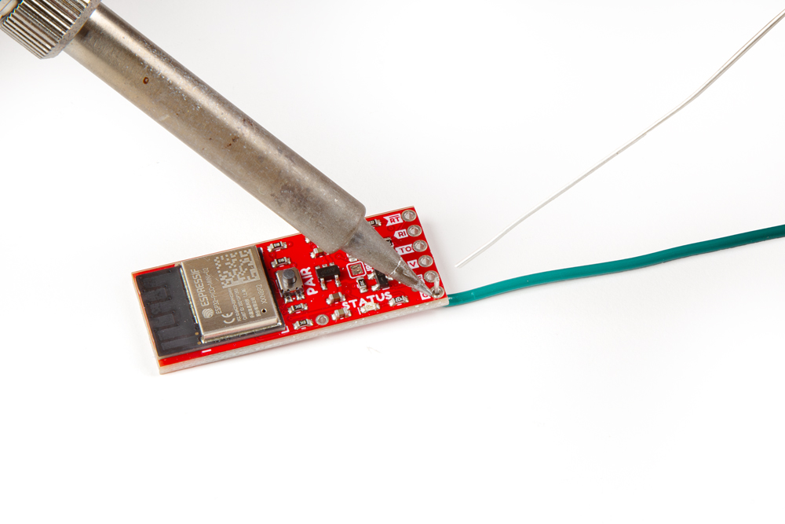{ width="400" }](./assets/img/hookup_guide/assembly-pth-wires.jpg "Click to enlarge")
<figcaption markdown>Soldering wires to the All-band GNSS RTK breakout board.</figcaption>
</figure>

??? info "Pin Layout - BlueSMiRF"
	

	

	<figure markdown>
	[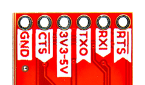{ width="330" }](./assets/img/hookup_guide/connection-pth-labels-bottom.png "Click to enlarge")
	<figcaption markdown>The labels for the PTH pads, on the bottom of the BlueSMiRF v2.</figcaption>
	</figure>

	

	

	<figure markdown>
	[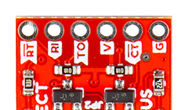{ width="330" }](./assets/img/hookup_guide/connection-pth-labels-top.png "Click to enlarge")
	<figcaption markdown>The labels for the  PTH pads, on the top of the BlueSMiRF v2.</figcaption>
	</figure>

	

	

	<article style="text-align: center;" markdown>

	<table border="1" markdown>
	<tr markdown>
	<th style="text-align:center; vertical-align:middle;" markdown>Pin Number</th>
	<th style="text-align:center;" markdown>`1` *(Left)*</th>
	<th style="text-align:center;" markdown>`2`</th>
	<th style="text-align:center;" markdown>`3`</th>
	<th style="text-align:center;" markdown>`4`</th>
	<th style="text-align:center;" markdown>`5`</th>
	<th style="text-align:center;" markdown>`6` *(Right)*</th>
	</tr>
	<tr markdown>
	<th style="vertical-align:middle;" markdown>Label</th>
	<td style="text-align:center; vertical-align:middle;" markdown>Top: `G` Bottom: `GND`</td>
	<td style="text-align:center; vertical-align:middle;" markdown>Top: `CT` Bottom: `CTS`</td>
	<td style="text-align:center; vertical-align:middle;" markdown>Top: `V` Bottom: `3V3-5V`</td>
	<td style="text-align:center; vertical-align:middle;" markdown>Top: `TO` Bottom: `TXO`</td>
	<td style="text-align:center; vertical-align:middle;" markdown>Top: `RI` Bottom: `RXI`</td>
	<td style="text-align:center; vertical-align:middle;" markdown>Top: `RT` Bottom: `RTS`</td>
	</tr>
	<tr markdown>
	<th style="vertical-align:middle;">Function</th>
	<td style="text-align:center; vertical-align:middle;" markdown>**Ground**</td>
	<td style="text-align:center; vertical-align:middle;" markdown>**Flow Control** *Clear-to-Send*</td>
	<td style="text-align:center; vertical-align:middle;" markdown>**Voltage Input** 3.3 to 5V</td>
	<td style="text-align:center; vertical-align:middle;" markdown>**UART** Transmit</td>
	<td style="text-align:center; vertical-align:middle;" markdown>**UART** Receive</td>
	<td style="text-align:center; vertical-align:middle;" markdown>**Flow Control** *Ready-to-Send*</td>
	</tr>
	</table>

	</article>
