!!! warning "What's New?"
	The design of the BlueSMiRF is similar to previous generations. However, we have made a few design improvements that users will appreciate. In testing, we got about ~110 feet (~33m) of range from a pair of BlueSMiRF v2s in the SparkFun building.

	- Features an ESP32-PICO-MINI-02 module programmed with our open-source firmware
		- Easily [update the firmware](firmware-overview.md#over-the-air-ota) Over-the-Air or through the serial interface
		- Configure the settings with AT-commands
	- A [user button](hardware-overview.md#pair-button) has been added to simplify pairing, triggering various modes of operation, and resetting the factory defaults
	- We manufacture three variants, with different connections to simplify hooking up the BlueSMiRF to your project
		- PTH pad and male header variants, which now have pin labels on both sides of the boards
		- JST variant that is easily connected to our high-precision GNSS breakout boards

	!!! info
		For a full background on the development and design revisions of the BlueSMiRF, check out the [**Board Revision History** page](revision_history.md) of this guide.

## Board Layout
The SparkFun BlueSMiRF v2 features the following:

<figure markdown>
[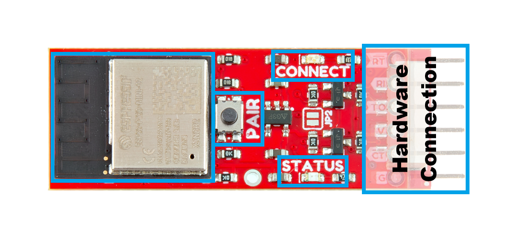{ width="400" }](./assets/img/hookup_guide/layout.png "Click to enlarge")
<figcaption markdown>The primary features of the BlueSMiRF v2 boards.</figcaption>
</figure>

<figure markdown>
[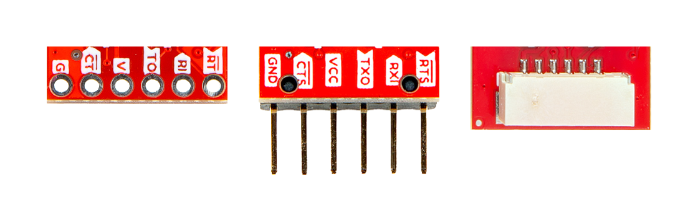{ width="600" }](./assets/img/hookup_guide/connection-options.png "Click to enlarge")
<figcaption markdown>The [connection options](hardware-overview.md#hardware-connection) for the BlueSMiRF v2: (from left; to right) 
PTH pads, male header pins, or JST-GH connector</figcaption>
</figure>

- [**ESP32 Module**](hardware-overview.md#esp32-pico-mini)
:   Espressif's ESP32-PICO-MINI-02 module

- [++"PAIR"++ **Button**](hardware-overview.md#pair-button)
:   A multi-use [button](hardware-overview.md#pair-button) that changes between the various [modes of operation](device-operation.md).

- [**Status LEDs**](hardware-overview.md#leds)
:   The green `CONNECT` and red `STATUS` LEDs are used to indicate various [modes of operation](device-operation.md).

- [**Hardware Connection**](hardware-overview.md#hardware-connection)
:   This connection breaks out the pins for the [UART interface](hardware-overview.md#uart-interface) and [power supply](hardware-overview.md#power-pins) for the BlueSMiRF. Additionally, the three variants provide different options for connecting the BlueSMiRF to their project.

<!-- Import the component -->

-   ## :material-folder-cog: Design Files

	---

	- :material-folder-zip: [Schematics](./assets/board_files/schematics.pdf)
		- :fontawesome-solid-file-pdf: [PTH Pads](./assets/board_files/schematic-pth.pdf)
		- :fontawesome-solid-file-pdf: [Male Header](./assets/board_files/schematic-smd.pdf)
		- :fontawesome-solid-file-pdf: [JST Connector](./assets/board_files/schematic-jst.pdf)
	- :material-folder-zip: [KiCad Files](./assets/board_files/kicad_files.zip)
		- :material-folder-zip: [PTH Pads](./assets/board_files/kicad_files-pth.zip)
		- :material-folder-zip: [Male Header](./assets/board_files/kicad_files-smd.zip)
		- :material-folder-zip: [JST Connector](./assets/board_files/kicad_files-jst.zip)
	- :material-folder-zip: [Board Dimensions](./assets/board_files/dimensions.pdf)
		- :fontawesome-solid-file-pdf: [PTH Pads](./assets/board_files/dimensions-pth.pdf):
			- 1.50" x 0.60" (38.1mm x 15.2mm)
		- :fontawesome-solid-file-pdf: [Male Header](./assets/board_files/dimensions-smd.pdf):
			- 1.74" x 0.60" (44.2mm x 15.2mm)
		- :fontawesome-solid-file-pdf: [JST Connector](./assets/board_files/dimensions-jst.pdf):
			- 1.60" x 0.60" (40.8mm x 15.2mm)
	- :material-folder-zip: [STEP Files](./assets/3d_model/step_files.zip)
		- :material-cube-outline: [PTH Pads](./assets/3d_model/cad_model-pth.step)
		- :material-cube-outline: [Male Header](./assets/3d_model/cad_model-smd.step)
		- :material-cube-outline: [JST Connector](./assets/3d_model/cad_model-jst.step)

-   <!-- Boxes in tabs -->

	=== "PTH Pads"
		<article style="margin: auto; text-align: center;" markdown>
		<model-viewer src="../assets/3d_model/web_model-pth.glb" poster="../assets/3d_model/poster-pth.png" camera-controls tone-mapping="neutral" poster="poster.webp" shadow-intensity="1" exposure="1" camera-orbit="0deg 60deg 0.09m" field-of-view="30deg" style="width: 100%; height: 450px;">
		</model-viewer>

		[Download the `*.step` File](./assets/3d_model/cad_model-pth.step "Click download"){ .md-button .md-button--primary}

		</article>

	=== "Male Header Pins"
		<article style="margin: auto; text-align: center;" markdown>
		<model-viewer src="../assets/3d_model/web_model-smd.glb" poster="../assets/3d_model/poster-smd.png" camera-controls tone-mapping="neutral" poster="poster.webp" shadow-intensity="1" exposure="1" camera-orbit="0deg 60deg 0.09m" field-of-view="30deg" style="width: 100%; height: 450px;">
		</model-viewer>

		[Download the `*.step` File](./assets/3d_model/cad_model-smd.step "Click download"){ .md-button .md-button--primary}

		</article>

	=== "JST-GH Connector"
		<article style="margin: auto; text-align: center;" markdown>
		<model-viewer src="../assets/3d_model/web_model-jst.glb" poster="../assets/3d_model/poster-jst.png" camera-controls tone-mapping="neutral" poster="poster.webp" shadow-intensity="1" exposure="1" camera-orbit="0deg 60deg 0.09m" field-of-view="30deg" style="width: 100%; height: 450px;">
		</model-viewer>

		[Download the `*.step` File](./assets/3d_model/cad_model-jst.step "Click download"){ .md-button .md-button--primary}

		</article>

	???+ question "How-to Manipulate 3D Model"
		<article style="text-align: center;" markdown>

		| Controls       | Mouse                    | Touchscreen    |
		| :------------- | :----------------------: | :------------: |
		| Zoom           | Scroll Wheel             | 2-Finger Pinch |
		| Rotate         | ++"Left-Click"++ & Drag  | 1-Finger Drag  |
		| Move/Translate | ++"Right-Click"++ & Drag | 2-Finger Drag  |

		</article>

### :material-ruler-square:{ .rotate-270 } Board Dimensions

<figure markdown>
[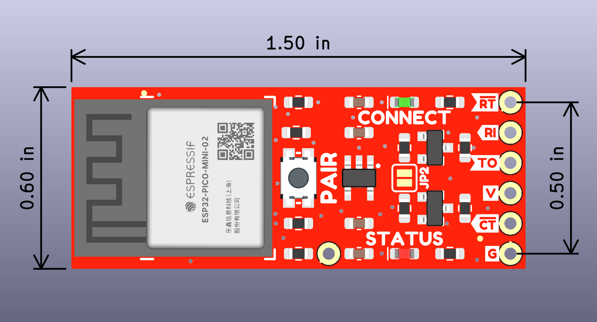{ width="400" }](./assets/board_files/dimensions-pth.png "Click to enlarge")
<figcaption markdown>Dimensions of the BlueSMiRF v2 - PTH.</figcaption>
</figure>

<figure markdown>
[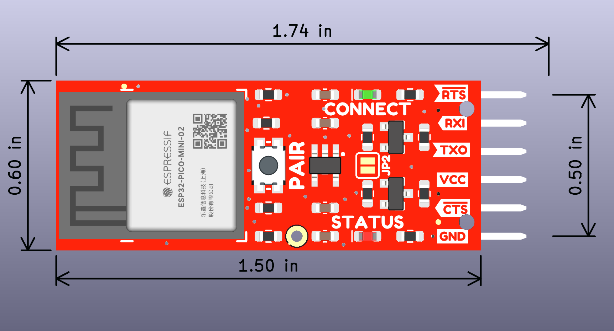{ width="400" }](./assets/board_files/dimensions-smd.png "Click to enlarge")
<figcaption markdown>Dimensions of the BlueSMiRF v2 - Header.</figcaption>
</figure>

<figure markdown>
[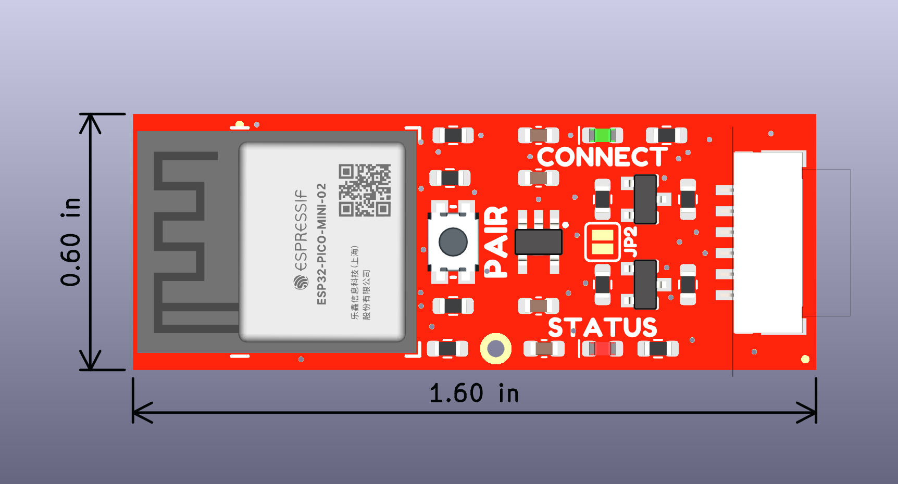{ width="400" }](./assets/board_files/dimensions-jst.png "Click to enlarge")
<figcaption markdown>Dimensions of the BlueSMiRF v2 - JST.</figcaption>
</figure>

???+ tip "Need More Dimensions?"
	For more board dimensions, users can download the [KiCad files](./assets/board_files/kicad_files.zip) for these board. These files can be opened in KiCad and measurements can be made with the measuring tool.

	!!! info ":octicons-download-16:{ .heart } KiCad - Free Download!"
		KiCad is free, open-source [CAD]("computer-aided design") program for electronics. Click on the button below to download their software. *(\*Users can find out more information about KiCad from their [website](https://www.kicad.org/).)*

		<article style="text-align: center;" markdown>
		[Download :kicad-primary:{ .enlarge-logo }](https://www.kicad.org/download/ "Go to downloads page"){ .md-button .md-button--primary}
		</article>

	??? info ":straight_ruler: Measuring Tool"
		This video demonstrates how to utilize the dimensions tool in KiCad, to include additional measurements:

		<article class="video-500px" style="text-align: center; margin: auto;" markdown>
		<iframe src="https://www.youtube.com/embed/-eXuD8pkCYw" title="KiCad Dimension Tool" frameborder="0" allow="accelerometer; autoplay; clipboard-write; encrypted-media; gyroscope; picture-in-picture" allowfullscreen></iframe>
		{ .qr width="85" }
		</article>

## ESP32 Pico-Mini
The brains of the BlueSMiRF v2 is an [ESP32 Pico-Mini module](https://espressif.com/sites/default/files/documentation/esp32-pico-mini-02_datasheet_en.pdf). The Espressif series of ESP32 modules are a versatile, compact MCU modules with WiFi, BT, and BLE capabilities that target a wide variety of applications. At the core of the ESP32 Pico-Mini module is the ESP32-PICO-V3-02, a System-in-Package device, along with an integrated 8 MB SPI flash, 2 MB SPI PSRAM, and 40 MHz oscillator. While the ESP32 Pico-Mini module has *twenty-seven multifunctional GPIO* that are available, only **seven of I/O pins** are actually utilized on the BlueSMiRF v2.

<figure markdown>
[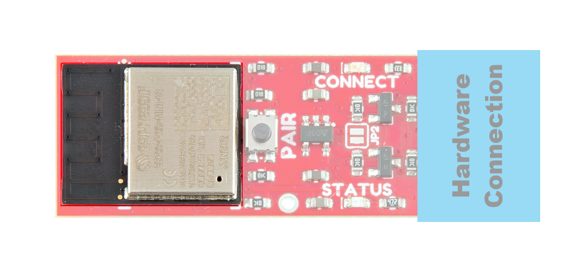{ width="600" }](./assets/img/hookup_guide/esp32.png "Click to enlarge")
<figcaption markdown>The ESP32 PICO-MINI-02 module on the BlueSMiRF v2.</figcaption>
</figure>

!!! note
	The ESP32 module can get a little warm when operating; don't be alarmed, this is just heat dissipating from the internal components.

	<figure markdown>
	[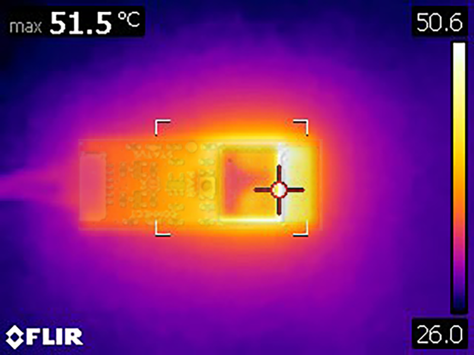{ width="400" }](./assets/img/hookup_guide/thermal.png "Click to enlarge")
	<figcaption markdown>A thermal image of the BlueSMiRF v2.</figcaption>
	</figure>

??? info "General Features"
	### Features

	

	

	- Electrical Characteristics:
		- Operating Voltage: **3.0 - 3.6V**
		- Current Consumption:
			- RF Operation: 368mA *(peak)*
			- Normal Operation: 20-31mA
			- Light-Sleep: 0.8mA
			- Deep-Sleep: 5µA
	- Xtensa® Dual-Core 32-bit LX6 Microprocessor *(up to 240MHz)*
		- 448KB of ROM and 520KB SRAM
		- 8MB SPI Flash
		- 2MB PSRAM
		- 16KB SRAM in RTC
	- Operating Temperature: -40 to 85&deg;C

	

	

	- PCB antenna
	- Wi­F 802.11b/g/n
		- Bit Rate: up to 150Mbps *(802.11n)*
		- Frequency Range: 2412 - 2484MHz
	- Bluetooth
		- Bluetooth v4.2 Specification:
			- BR/EDR
			- Bluetooth LE
		- Transmitter Class: 1, 2, and 3
	- 27 GPIO *(including strapping pins)*
	- Other Supported Peripherals:
		- SD card, SDIO, I2S, IR, pulse counter, TWAI/CAN, Ethernet MAC

	

	

	With the [pin multiplexing](https://docs.espressif.com/projects/arduino-esp32/en/latest/tutorials/io_mux.html?#id1) capabilities of the ESP32 SoC, various pins can have several functionalities. For more technical specifications on the **I/O** pins, please refer to the [ESP32 SoC datasheet](./assets/component_documentation/esp32_datasheet_en.pdf).

	- 18x 12-bit analog to digital converter (ADC) channels
	- 3x UARTs (only two are configured by default in the Arduino IDE, one UART is used for bootloading/debug)
	- 3x SPI (only one is configured by default in the Arduino IDE)
	- 2x I^2^C (only one is configured by default in the Arduino IDE)
	- 2x digital-to-analog converter (DAC) channels
	- 16x 20-bit PWM outputs
	- 10x Capacitive Touch Inputs

	

	

	!!! warning
		Users should be aware of the following nuances of the ESP32 Pico-Mini module:

		- All the GPIO are **3.3V** pins.
			- The I/O pins are **not 5V-tolerant**! To interface with higher voltage components, a [**logic level adapter**](https://learn.sparkfun.com/tutorials/bi-directional-logic-level-converter-hookup-guide) is recommended.
		- The ESP32 Pico-Mini is only compatible with **2.4GHz WiFi** networks; it will not work on the 5GHz bands.
		- There are electrical limitations to the amount of current that the ESP32 Pico-Mini module can sink or source. For more details, check out the [ESP32 Pico-Mini module datasheet](./assets/component_documentation/esp32-pico-mini-02_datasheet_en.pdf).
		- There are some limitations to the ADC performance, see the **Note** from the [**ADC Characteristics** section of the ESP32 SoC datasheet](./assets/component_documentation/esp32_datasheet_en.pdf).
		- For details on the boot mode configuration, please refer to [section **3.3 Strapping Pins**](./assets/component_documentation/esp32_datasheet_en.pdf#8) of the ESP32 SoC datasheet.

	???+ abstract "Power Modes"
		The ESP32 Pico-Mini module has various power modes:

		- **Active** -  The chip radio is powered on. The chip can receive, transmit, or listen.
		- **Modem Sleep** - The CPU is operational and the clock is configurable. The Wi-Fi/Bluetooth baseband and radio are disabled.
		- **Light Sleep** - The CPU is paused. The RTC memory and RTC peripherals, as well as the ULP coprocessor are running.
		- **Deep Sleep** - Only the RTC memory and RTC peripherals are powered on. The ULP coprocessor is functional.
		- **Hibernation** - Only one RTC timer on the slow clock and certain RTC GPIO active.
		- **Off** - Chip is powered off.

		*For more information on the power management of the ESP32 Pico-Mini module, pleaser refer to **Section 4.4** and **Tables: 8 and 9** of the [ESP32 Pico-Mini module datasheet](./assets/component_documentation/esp32-pico-mini-02_datasheet_en.pdf).*

??? info "Pin Connections"
	### Pin Connections
	The ESP32 Pico-Mini module features *twenty-seven multifunctional GPIO* pins; however, only *seven of I/O pins** are actually utilized for the BlueSMiRF v2.

	

	

	<figure markdown>
	[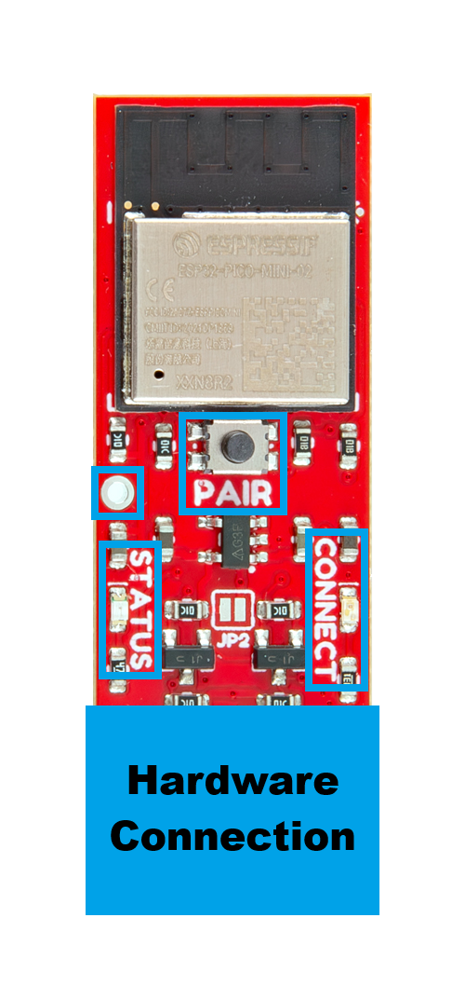{ width="230" }](./assets/img/hookup_guide/peripherals.png "Click to enlarge")
	<figcaption markdown>The ESP32 GPIO pins utilized on the BlueSMiRF v2.</figcaption>
	</figure>

	

	

	| ESP32 Pins    | BlueSMiRF         |
	| :-----------: | :---------------- |
	| `EN`          | `RST` PTH Pad     |
	| `GPIO 0`      | ++"Pair"++ Button |
	| `GPIO 1`      | `TX` Pin          |
	| `GPIO 3`      | `RX` Pin          |
	| `GPIO 8`      | `STATUS` LED      |
	| `GPIO 13`     | `CONNECT` LED     |
	| ~~`GPIO 15`~~ | Disables Debug    |
	| `GPIO 19`     | `CTS` Pin         |
	| `GPIO 22`     | `RTS` Pin         |

	

	

??? info "Firmware"
	### Firmware
	--8<-- "./docs/firmware-overview.md::14"

	### Performance
	Testing a pair of BlueSMiRF v2s and we were able to achieve a range of ~110 feet (~33m) in the SparkFun building.

!!! tip "Bootloader Mode"
	Users can manually force the ESP32 into the <a href="https://docs.espressif.com/projects/esptool/en/latest/esp32/advanced-topics/boot-mode-selection.html#select-bootloader-mode">serial bootloader mode</a> with the ++"PAIR"++ button, to upload new firmware to the BlueSMiRF v2. Please, refer to the [**++"PAIR"++ Button** section](hardware-overview.md#pair-button) below for more information.

??? arduino "Programming the ESP32 in Arduino"
	To program the ESP32 Pico-Mini module in the Arduino IDE, users should select the **ESP32** > **ESP32 Dev Module** from the Board Manager list. Users should also be aware that not all of the capabilities, listed above, are available in the Arduino IDE; the Espressif IDF should be utilized for the full capabilities of the ESP32. When programming the module with the Arduino IDE, only the following peripherals are supported:

	- Only two UART interfaces are available.
	- Only one SPI bus is defined.
	- Only one I^2^C bus is defined.

	For more technical specifications on the **I/O** pins, you can refer to the [schematics](./assets/board_files/schematics.pdf), [ESP32 Pico-Mini module datasheet](./assets/component_documentation/esp32-pico-mini-02_datasheet_en.pdf), [ESP32 SoC datasheet](./assets/component_documentation/esp32_datasheet_en.pdf), and [documentation for the ESP32 Arduino core](https://docs.espressif.com/projects/arduino-esp32/en/latest/tutorials/io_mux.html?#peripherals).

	=== "Digital Pins"
		Any of the GPIO pins of the ESP32 module can function as digital pins. In the Arduino IDE, users will need to declare the [**`pinMode()`** function](https://docs.arduino.cc/language-reference/en/functions/digital-io/pinMode/) for the pins used in this manner, in the setup of their **sketch**.

		

		- **Input**

			---

			When configured properly, an **input** pin will be looking for a `HIGH` or `LOW` state. This functionality is accessed in the Arduino IDE using the [`digitalRead(pin)` function](https://docs.arduino.cc/language-reference/en/functions/digital-io/digitalread/). By default, in the Arduino IDE, `digitalRead()` returns a boolean value. **Input** pins are *high impedance* and takes very little current to move the input pin from one state to another.

		- **Output**

			---

			When configured as an **output** the pin will be at a `HIGH` or `LOW` voltage. This functionality is accessed in the Arduino IDE using the [`digitalWrite(pin, value)` function](https://docs.arduino.cc/language-reference/en/functions/digital-io/digitalwrite/). **Output** pins are *low impedance*; this means that they can provide a relatively substantial amount of current to other circuits.

		

	=== "Analog Pins"
		The ESP32 module provides a **12-bit ADC** (Analog Digital Converters) input on eighteen of its I/O pins. This functionality is accessed in the Arduino IDE using the [`analogRead(pin)` function](https://docs.arduino.cc/language-reference/en/functions/analog-io/analogRead/). By default, in the Arduino IDE, `analogRead()` returns a 10-bit value. To change the resolution of the value returned by the `analogRead()` function, use the [`analogReadResolution(bits)` function](https://docs.arduino.cc/language-reference/en/functions/analog-io/analogReadResolution/).

	=== "PWM Pins"
		The ESP32 module supports up to sixteen channels of **20-bit PWM** (Pulse Width Modulation) outputs on any of its I/O pins. This is accessed in the Arduino IDE using the [`analogWrite(pin, value)` function](https://docs.arduino.cc/language-reference/en/functions/analog-io/analogWrite/). By default, in the Arduino IDE, `analogWrite()` accepts an 8-bit value. To change the resolution of the PWM signal for the `analogWrite()` function, use the [`analogWriteResolution(bits)` function](https://docs.arduino.cc/language-reference/en/functions/analog-io/analogWriteResolution/).

	=== "DAC Pins"
		The ESP32 module supports up to two **8-bit DAC** (Digital Analog Converters) outputs. This is accessed in the Arduino IDE using the [`dacWrite(pin, value);` function](https://docs.espressif.com/projects/arduino-esp32/en/latest/api/dac.html). By default, in the Arduino IDE, the **ESP32 Dev Module** board definition supports:

		<article style="text-align: center;" markdown>

		| **DAC1** | `GPIO 25` |
		| :------: | :-------- |
		| **DAC2** | `GPIO 26` |

		</article>

	=== "Serial Pins"
		The ESP32 module provides three UART ports. By default, the UART ports for `Serial` and `Serial1` can be accessed through the Arduino IDE using the [serial communication class](https://docs.arduino.cc/language-reference/en/functions/communication/serial/). By default, in the Arduino IDE, the **ESP32 Dev Module** board definition supports:

		

		-   **`Serial` UART Port**

			---

			<article style="text-align: center;" markdown>

			| **RX0** | `GPIO 1` |
			| :-----: | :------: |
			| **TX0** | `GPIO 3` |

			</article>

		-   **`Serial1` UART Port**

			---

			<article style="text-align: center;" markdown>

			| **RX1** | `GPIO 21` |
			| :-----: | :-------: |
			| **TX1** | `GPIO 22` |

			</article>

		

		!!! tip
			We have noticed that with the ESP32 Arduino core, `Serial.available()` does not operate instantaneously. This is due to an interrupt triggered by the UART, to empty the FIFO when the **`RX`** pin is inactive for two byte periods:

			- At 9600 baud, `hwAvailable` takes about **11 ms** before the UART indicates that data was received from: `\r\nERROR\r\n`.

				$$
				(bytes + 2) * 1ms = 11ms
				$$

			- At 115200 baud, `hwAvailable` takes about **1 ms** before the UART indicates that data was received from: `\r\nERROR\r\n`.

				$$
				(bytes + 2) * .087ms = 1ms
				$$

			*For more information, please refer to this [chatroom discussion](https://gitter.im/espressif/arduino-esp32?at=5e25d6370a1cf54144909c85).*

	=== "SPI Pins"
		The ESP32 module provides three SPI buses. By default, in the Arduino IDE, the [SPI class](https://docs.arduino.cc/language-reference/en/functions/communication/SPI/) is configured to utilize pins `GPIO 32` (SCK), `GPIO 25` (POCI), `GPIO 26` (PICO), and `GPIO 27` (`SS`) for its chip select. In order to utilize the other SPI ports or objects, users will need to create a custom SPI object and declare which pins to access. By default, in the Arduino IDE, the **ESP32 Dev Module** board definition supports:

		<article style="text-align: center;" markdown>

		| **SCK**             | `GPIO 32` (`SCK`)  |
		| :-----------------: | :----------------: |
		| **SDI** or **POCI** | `GPIO 25` (`MISO`) |
		| **SDO** or **PICO** | `GPIO 26` (`MOSI`) |
		| *CS**               | `GPIO 27` (`SS`)   |

		</article>

		??? info "Signal Nomenclature"
			To comply with the latest [OSHW](https://www.oshwa.org/) design practices, we have [adopted the new SPI signal nomenclature](https://www.sparkfun.com/spi_signal_names) (**SDO**/**SDI** and **PICO**/**POCI**). The terms Master and Slave are now referred to as Controller and Peripheral. The `MOSI` signal on a controller has been replaced with `SDO` or `PICO`. Please refer to this [announcement on the decision to deprecate the **MOSI**/**MISO** terminology and transition to the **SDO**/**SDI** naming convention](https://www.oshwa.org/a-resolution-to-redefine-spi-signal-names).

	=== "I^2^C Pins"
		The ESP32 module module can support up to two I^2^C buses. By default, in the Arduino IDE, the [Wire class](https://www.arduino.cc/en/reference/wire) is configured to utilize pins `GPIO 20` (SDA) and `GPIO 7` (SCL). In order to utilize another I^2^C port, users will need to create a custom Wire object and declare which pins to access. By default, in the Arduino IDE, the **ESP32 Dev Module** board definition supports:

		<article style="text-align: center;" markdown>

		| **SCL0** | `GPIO 7` (`SCL`)  |
		| :------: | :---------------: |
		| **SDA0** | `GPIO 20` (`SDA`) |

		</article>

## Hardware Connection
Each variant of the BlueSMiRF v2, has a different hardware connection option. Users can purchase a board variant with either PTH pads, male header pins, or JST-GH connector to suite their needs.

<figure markdown>
[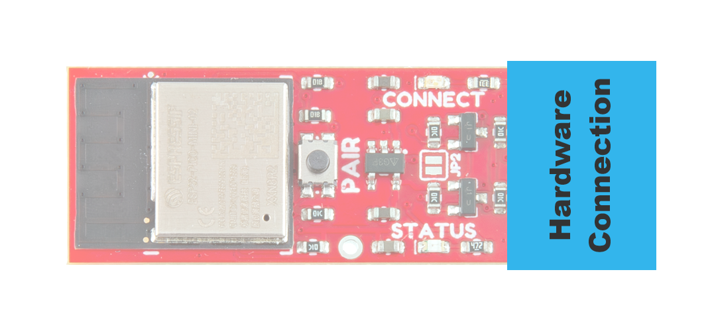{ width="400" }](./assets/img/hookup_guide/connection.png "Click to enlarge")
<figcaption markdown>The hardware connection on the BlueSMiRF v2.</figcaption>
</figure>

<figure markdown>
[{ width="600" }](./assets/img/hookup_guide/connection-options.png "Click to enlarge")
<figcaption markdown>The connection options for the board variants: (from left; to right) 
PTH pads, male header pins, or JST-GH connector.</figcaption>
</figure>

The pin layout for these connections, are summarized in the table below. The pin numbers are ordered from left-to-right, as viewed from the side facing the connection.

<figure markdown>
[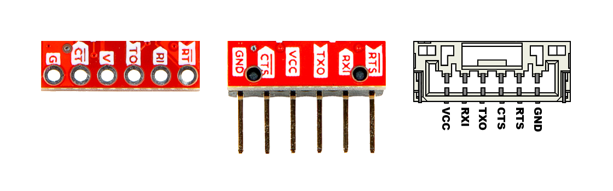{ width="600" }](./assets/img/hookup_guide/pins.png "Click to enlarge")
<figcaption markdown></figcaption>
</figure>

<article style="text-align: center;" markdown>

<table border="1" markdown>
<tr markdown>
<th style="text-align:center; vertical-align:middle;" markdown>Connection Type</th>
<th style="text-align:center;" markdown>`1` *(Left)*</th>
<th style="text-align:center;" markdown>`2`</th>
<th style="text-align:center;" markdown>`3`</th>
<th style="text-align:center;" markdown>`4`</th>
<th style="text-align:center;" markdown>`5`</th>
<th style="text-align:center;" markdown>`6` *(Right)*</th>
</tr>
<tr markdown>
<th markdown>PTH Pads Male Header Pins</th>
<td style="text-align:center; vertical-align:middle;" markdown>`GND`</td>
<td style="text-align:center; vertical-align:middle;" markdown>`CTS`</td>
<td style="text-align:center; vertical-align:middle;" markdown>`VCC`</td>
<td style="text-align:center; vertical-align:middle;" markdown>`TXO`</td>
<td style="text-align:center; vertical-align:middle;" markdown>`RXI`</td>
<td style="text-align:center; vertical-align:middle;" markdown>`RTS`</td>
</tr>
<tr markdown>
<th markdown>JST Connector</th>
<td style="text-align:center;" markdown>`VCC`</td>
<td style="text-align:center;" markdown>`RXI`</td>
<td style="text-align:center;" markdown>`TXO`</td>
<td style="text-align:center;" markdown>`CTS`</td>
<td style="text-align:center;" markdown>`RTS`</td>
<td style="text-align:center;" markdown>`GND`</td>
</tr>
</table>

</article>

??? warning "Backwards Compatibility"
	The pin layout of the BlueSMiRF v2 variants with the [PTH pads](https://www.sparkfun.com/sparkfun-bluesmirf-v2.html) and [male header pins](https://www.sparkfun.com/sparkfun-bluesmirf-v2-headers.html), will only be backwards compatible with previous versions of the [BlueSMiRF Mate](revision_history.md#mate-header), as shown in the image below.

	<figure markdown>
	[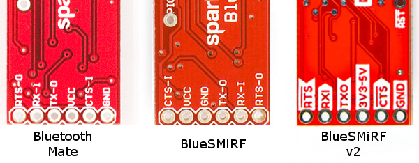{ width="600" }](./assets/img/hookup_guide/revision-pinout-all.jpg "Click to enlarge")
	<figcaption markdown>Pin compatibility of different generations of the BlueSMiRF.</figcaption>
	</figure>

### Power Pins
The BlueSMiRF v2 only requires **3.3V** and is powered through the `VCC` and `GND` pins of its hardware connection.

<figure markdown>
[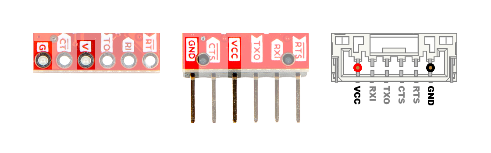{ width="600" }](./assets/img/hookup_guide/pins-power.png "Click to enlarge")
<figcaption markdown>The power pins from the BlueSMiRF v2's hardware connection.</figcaption>
</figure>

Below, is a general summary of the power circuitry:

- **`VCC`** - The input voltage for the BlueSMiRF v2, provided from its hardware connection
	- Supplies the [AP2112](./assets/component_documentation/AP2112.pdf) LDO regulator
		- Input Voltage Range: **3.3 to 6.0V** (1)
		- Powers the [ESP32 module](hardware-overview.md#esp32-pico-mini), [LEDs](hardware-overview.md#leds), and lower voltage of the logic-level shifters
		- The voltage regulator can be bypassed with the [`JP2` jumper](hardware-overview.md#jumpers)
- **`GND`** - The common ground or the 0V reference for the voltage supplies.

1. While the input voltage range for the AP2112 LDO voltage regulator is 2.5 to 6.0V, we recommend a minimum input voltage of **3.3V** to prevent the ESP32 module browning out.

???+ tip "Power Consumption"
	The board's power consumption is based on its operation. Here are some of estimates based on our measurements at 3.3V.

	- Idle: 72mA / 238mW
	- Connected with No Traffic: 75mA / 248mW
	- Connected with Duplex Traffic: 140mA / 462mW

!!! info
	For more details, users can reference the [schematics](./assets/board_files/schematics.pdf) and the datasheets of the individual components on the board.

### UART Interface
The UART interface provides access to the primary function of the BlueSMiRF v2. It supports full-duplex data transmission for baud rates ranging between **2400-921600bps**.

<figure markdown>
[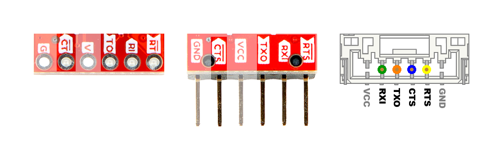{ width="600" }](./assets/img/hookup_guide/pins-uart-all.png "Click to enlarge")
<figcaption markdown>The pins of the UART interface for the BlueSMiRF v2.</figcaption>
</figure>

<article style="text-align: center;" markdown>

| **Device 1** | `RX` | `TX` | `CTS` | `RTS` |
| :----------- | :--: | :--: | :---: | :---: |
| **Device 2** | `TX` | `RX` | `RTS` | `CTS` |
<figcaption markdown>The UART signals cross-coupled between two devices</figcaption>

</article>

Below, is a general summary of the UART interface:

-   **Data Bus**

	---

	- Features logic-level converters; the higher voltage is supplied by `VCC`
	- Full-duplex support (simultaneous/bidirectional communication)
	- **`RXI`** - Data input to the BlueSMiRF v2 from its hardware connection
		- If connected, data received from the `RXI` pin is piped to its Bluetooth connection
		- Buffer Size: 51kB
	- **`TXO`** - Data output from the BlueSMiRF v2 to its hardware connection
		- If connected, data received from the Bluetooth connection is piped to its `TXO` pin
		- Buffer Size: 10kB

	!!! info
		By default, the baud rate is configured to **115200bps**. Use the `AT-SerialSpeed` command to change this setting.

-   **Flow Control** *(Optional)*

	---

	- Direct connection to GPIO; no logic-level conversion
	- Does not support **legacy** *hardware flow control* for DTE (Data Terminal Equipment) and DCE (Data Communications Equipment)
	- **`CTS`** - Connected device, controls data transmission from BlueSMiRF v2
		- `HIGH`: Connected device, signaling that it is ready for data to be sent
		- `LOW`: Connected device, signaling that the data transmission needs to be halted
	- **`RTS`** - Controls data transmission to the BlueSMiRF v2
		- `HIGH`: BlueSMiRF v2 is ready for data to be transmitted to it
		- `LOW`: BlueSMiRF v2 buffer is full; asserts `LOW` to halt data transmission

	!!! info
		By default, the flow control pins are disabled in the firmware. Use the `AT-FlowControl=1` command to enable them.

	!!! tip
		The flow control pins aren't necessary for the BlueSMiRF v2 to function. However, when enabled, it assists with buffer control, device latency, and data synchronization.

!!! tip
	These data bus and flow control signals need to be cross-coupled between the two devices.

## ++"Pair"++ Button
The ++"PAIR"++ button is used to switch between the various [modes of operation](device-operation.md) for the BlueSMiRF v2. It is used to simplify pairing, triggering various modes of operation, and restoring the settings to their factory defaults.

<figure markdown>
[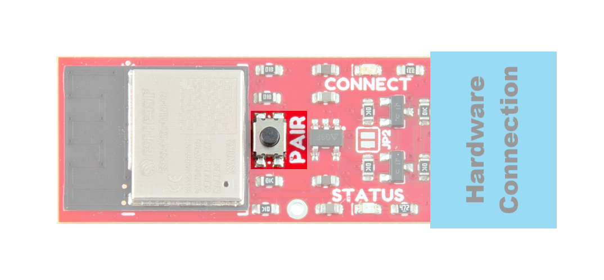{ width="600" }](./assets/img/hookup_guide/button.png "Click to enlarge")
<figcaption markdown>++"PAIR"++ Button on the BlueSMiRF v2.</figcaption>
</figure>

- Discoverable Mode
	- A default state, where the `STATUS` LED will **fade in-and-out a few times** to indicate the device is ready to be paired with a Bluetooth device.
- BlueSMiRF Pairing Mode
	- Used to pair the BlueSMiRF v2 with another BlueSMiRF v2 in the *(default)* **discoverable mode**.
	- Press and hold the ++"PAIR"++ button down for 4 - 8sec, the `CONNECT` and `STATUS` LED will **blink back-and-forth**.
		- If the ++"PAIR"++ button is continued to be held, the device will transition to a **factory reset** *(see below)*.
	- If the BlueSMiRF v2 hasn't been discovered or paired with the other BlueSMiRF v2 after a few seconds, it will return to the *(default)* **discoverable mode** and the `STATUS` LED will **fade in-and-out a few times** to indicate the transition.
- Bootloader Mode
	- Used to manually update the firmware through the [UART interface](hardware-overview.md#uart-interface).
	- To enter bootloader mode, users will need to hold down the ++"PAIR"++ button while the BlueSMiRF v2 is not powered.
	- Continue holding down the ++"PAIR"++ button, while applying power to put the [microcontroller](hardware-overview.md#esp32-pico-mini) into bootloader mode.
	- Release the button, to upload new firmware.
- Factory Reset
	- Press and hold the ++"PAIR"++ button down for more than 8sec, the `CONNECT` and `STATUS` LED will **blink back-and-forth, rapidly**.
	- Once the user releases the button, the original factory settings are be applied and the BlueSMiRF v2 resets. Then, it returns to the *(default)* **discoverable mode**.

## LEDs
The BlueSMiRF v2 has two status LEDs, which function differently based on the Bluetooth connection and/or datastream status; in conjunction with the device's `AT-LedStyle` configuration setting and operation mode:

<figure markdown>
[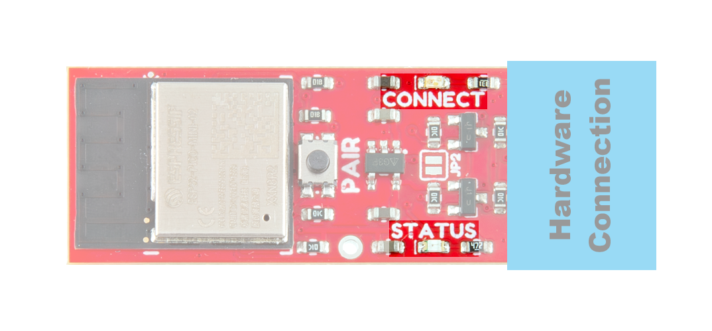{ width="600" }](./assets/img/hookup_guide/LEDs.png "Click to enlarge")
<figcaption markdown>The status indication LEDs on the BlueSMiRF v2.</figcaption>
</figure>

- Normal Operation

	???+ note "Setting: `AT-LedStyle=0` *(Default)*"
		- `CONNECT` - Indicates the Bluetooth connection status
			- **Discoverable Mode:** This LED will **blink**, while the BlueSMiRF v2 is available to be paired with.
			- **Active Connection:** This LED will **turn solid**, once the BlueSMiRF v2 has an active Bluetooth connection
		- `STATUS` - Indicates the status of the UART datastream
			- **Data Transmission:** The `STATUS` LED will **blink**, as data is sent to the BlueSMiRF v2.

	??? note "Setting: `AT-LedStyle=1`"
		- `CONNECT` - Indicates the Bluetooth connection status and the status of the `TXO` datastream
			- **Discoverable Mode:** This LED will **blink, regularly**, while the BlueSMiRF v2 awaits for an active Bluetooth connection.
			- **Active Connection**
				- **Initial Connection:** Upon an initial connection, this LED will **remain solid** until data is passed through the `TXO` pin of the BlueSMiRF v2.
				- **Data Transmission:** This LED will **blink** as data is passed through the `TXO` pin of the BlueSMiRF v2.
		- `STATUS` - Indicates the status of the `RXI` datastream
			- **Data Transmission:** This LED will **blink**, as data is passed through the `RXI` pin of the BlueSMiRF v2; regardless of the Bluetooth connection status.

- Pairing Mode
	- After the ++"PAIR"++ button has been held down for 4-8sec, the `CONNECT` and `STATUS` LED will **blink back-and-forth**.
		- If the ++"PAIR"++ button is continued to be held, the device will transition to a **factory reset** *(see below)*.
	- After a few seconds in pairing mode, if the BlueSMiRF v2 hasn't been paired with, it will return to the *(configured)* **discoverable mode** and the `STATUS` LED will **fade in-and-out a few times** to indicate the transition.
- Factory Reset
	- After the ++"PAIR"++ button has been held down past 8sec sec, the `CONNECT` and `STATUS` LED will **blink back-and-forth, rapidly**.
	- Once the user releases the button, the original factory settings are be applied and the BlueSMiRF v2 resets. Then, it returns to the *(default)* **discoverable mode**.
- Command Mode
	- Upon entering command mode, the `CONNECT` and `STATUS` LED will **blink simultaneously**.
	- After an AT-command has been initially sent sent:

		???+ note "Setting: `AT-LedStyle=0` *(Default)*"
			The LEDs will then return to functioning in the *(default)* **normal operation**.

		??? note "Setting: `AT-LedStyle=1`"
			The LEDs will continue to **blink simultaneously**.

## Reset Pin
The reset pin for the ESP32 is connected to the `RST` PTH pad. Pulling this pin `LOW` will restart the ESP32.

<figure markdown>
[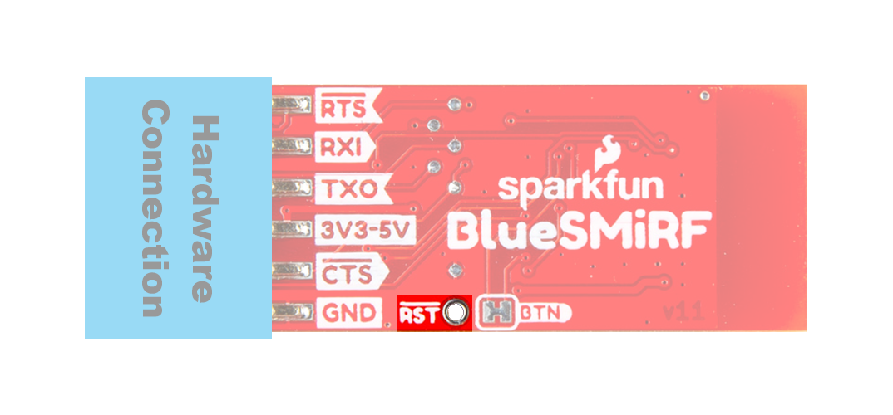{ width="600" }](./assets/img/hookup_guide/reset.png "Click to enlarge")
<figcaption markdown>The reset PTH pad on the BlueSMiRF v2.</figcaption>
</figure>

!!! tip
	This is primarily provided for our production team, as a test point for programming and testing the board. However, users can use it when reprogramming the [ESP32 microcontroller](hardware-overview.md#esp32-pico-mini).

## Jumpers

??? note "Never modified a jumper before?"
	Check out our <a href="https://learn.sparkfun.com/tutorials/664">Jumper Pads and PCB Traces tutorial</a> for a quick introduction!

	

	-  <a href="https://learn.sparkfun.com/tutorials/664">
		<figure markdown>
		
		</figure>

		---

		**How to Work with Jumper Pads and PCB Traces**</a>

	

There are two jumpers on these board that can be used to easily modify the hardware connections.

**`JP2`**
:   This jumper can be closed to [bypass the 3.3V voltage regulator](hardware-overview.md#power-pins); directly passing power from the `VCC` pin to all the components on the `3V3` power rail.

	<figure markdown>
	[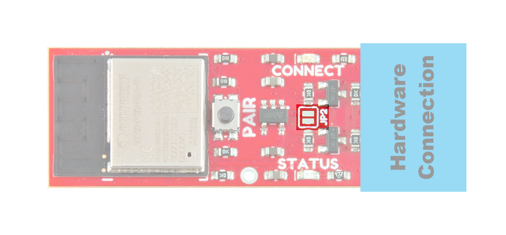{ width="600" }](./assets/img/hookup_guide/jumpers-top.png "Click to enlarge")
	<figcaption markdown>The `JP2` jumper on the top of the BlueSMiRF v2.</figcaption>
	</figure>

	!!! danger
		Please be aware of the voltage ratings for all the components, before proceeding with this modification. Exceeding the electrical specifications of certain components will permanently damage and/or disable them.

**`BTN`**
:   This jumper can be cut to disconnect the [++"PAIR"++ button](hardware-overview.md#pair-button) from the `GPIO 0` pin of the ESP32.

	<figure markdown>
	[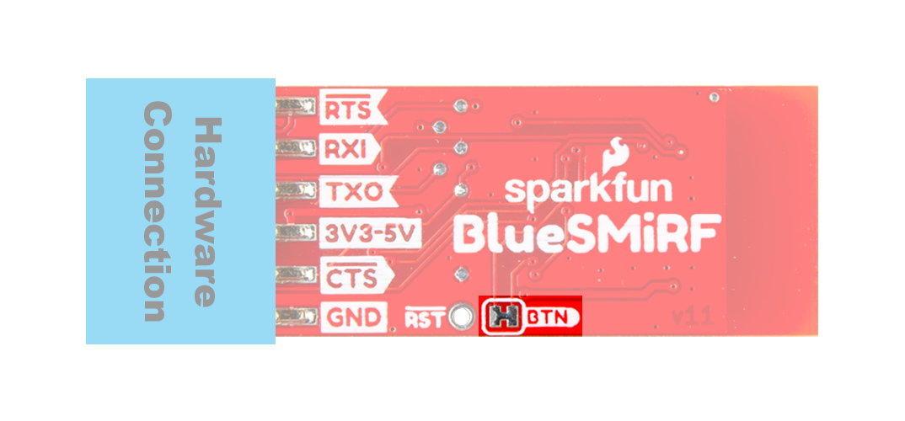{ width="600" }](./assets/img/hookup_guide/jumpers-bottom.png "Click to enlarge")
	<figcaption markdown>The `BTN` jumper on the bottom of the BlueSMiRF v2.</figcaption>
	</figure>
