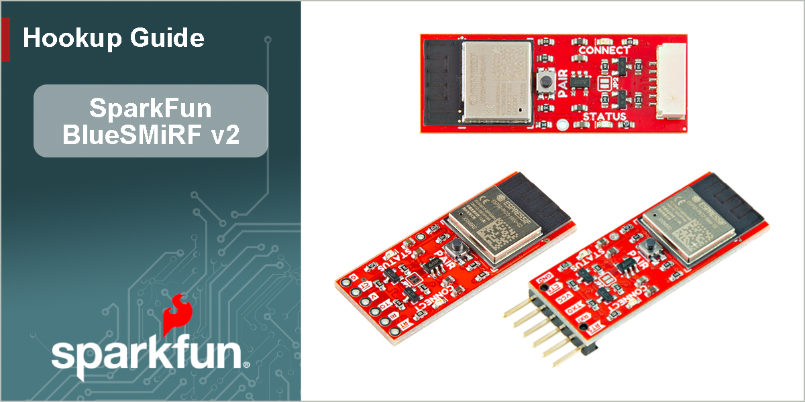

<article style="text-align: center;" markdown>
{ width="650px" }
</article>

# Introduction

<article class="video-container" style="margin: auto;" markdown>
<iframe src="https://www.youtube.com/embed/i8u3W0jVFTw?si=9iwrsCm9Ih9n9VCz" title="Product Showcase: SparkFun BlueSMiRF v2" frameborder="0" allow="accelerometer; autoplay; clipboard-write; encrypted-media; gyroscope; picture-in-picture" allowfullscreen></iframe>
</article>

-   Our BlueSMiRF product line is a series of wireless Bluetooth&reg; serial links. The SparkFun BlueSMiRF v2 is a reboot of the previous [BlueSMiRF board](https://www.sparkfun.com/sparkfun-bluetooth-mate-silver.html), utilizing the Espressif's ESP32 Pico Mini for wireless communication and comes in several variants, with [PTH pads](https://www.sparkfun.com/sparkfun-bluesmirf-v2.html), [male header pins](https://www.sparkfun.com/sparkfun-bluesmirf-v2-headers.html), or a [JST connector](https://www.sparkfun.com/sparkfun-bluesmirf-v2-jst.html). These boards operate as a serial data link and are a great replacement for hardwired between boards. Simply connect a BlueSMiRF v2, pair the devices over Bluetooth&reg;, and simultaneously transmit and receive data! Any serial stream from **2400 - 921600bps** can be passed between two devices; with a range of **100' (33m)**. In this tutorial, we'll go over the hardware and the connections to a BlueSMiRF v2. We will also provide a few examples; including, how to connect to the BlueSMiRF v2 with a smartphone and a basic Arduino example transmitting data between two BlueSMiRF v2s... so [let's get started!](hardware-overview.md)

## Variants

-   <a href="https://www.sparkfun.com/sparkfun-bluesmirf-v2.html">
	**SparkFun BlueSMiRF v2 - PTH Pins** 
	**SKU:** WRL-24113

	---

	<figure markdown>
	
	</figure></a>

	<article style="text-align: center;" markdown>
	[Purchase from SparkFun :fontawesome-solid-cart-plus:](https://www.sparkfun.com/sparkfun-bluesmirf-v2.html){ .md-button .md-button--primary }
	</article>

-   <a href="https://www.sparkfun.com/sparkfun-bluesmirf-v2-headers.html">
	**SparkFun BlueSMiRF v2 - Male Header** 
	**SKU:** WRL-23287

	---

	<figure markdown>
	
	</figure></a>

	<article style="text-align: center;" markdown>
	[Purchase from SparkFun :fontawesome-solid-cart-plus:](https://www.sparkfun.com/sparkfun-bluesmirf-v2-headers.html){ .md-button .md-button--primary }
	</article>

-   <a href="https://www.sparkfun.com/sparkfun-bluesmirf-v2-jst.html">
	**SparkFun BlueSMiRF v2 - JST Connector** 
	**SKU:** WRL-30414

	---

	<figure markdown>
	
	</figure></a>

	<article style="text-align: center;" markdown>
	[Purchase from SparkFun :fontawesome-solid-cart-plus:](https://www.sparkfun.com/sparkfun-bluesmirf-v2-jst.html){ .md-button .md-button--primary }
	</article>

## Section Topics
This guide is divided into several sections:

- The **Quickstart Guide** assumes a working knowledge of the BlueSMiRF v2 and the required software to configure it for your project's needs. It only covers basic hardware information and assembly instructions users would need to get started with this product.
- The **Hardware** section has two sub-sections that provide:
	- An overview of the board's design, major components, and interfaces. Refer to this page for information on the connectors, breakout pins, and jumpers.
	- Assembly instructions for this product's interface.
- The **Operation** section has two sub-sections that discuss the device operation and configuration settings.
- The **Firmware** section has two sub-sections covering the open-source firmware and its dependencies; including instructions for updating the firmware on the device.
- The **Examples** section includes multiple demonstrations of the product's capabilities.
	- *To follow along with the examples in this tutorial, users will require the specified products.*
- In the **Resources and Support** section, users can find the design files (KiCad files & schematic), relevant documentation (datasheets, white papers, etc.) and other helpful links on the Resources page.
	- The **Troubleshooting** page includes helpful tips and instructions for how to receive technical support from SparkFun.
