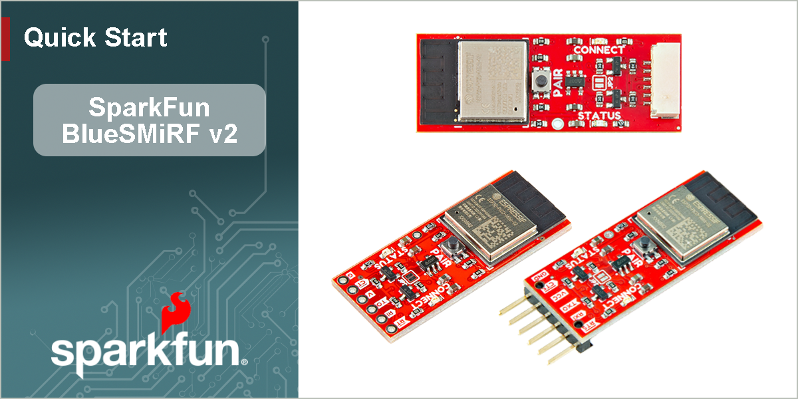
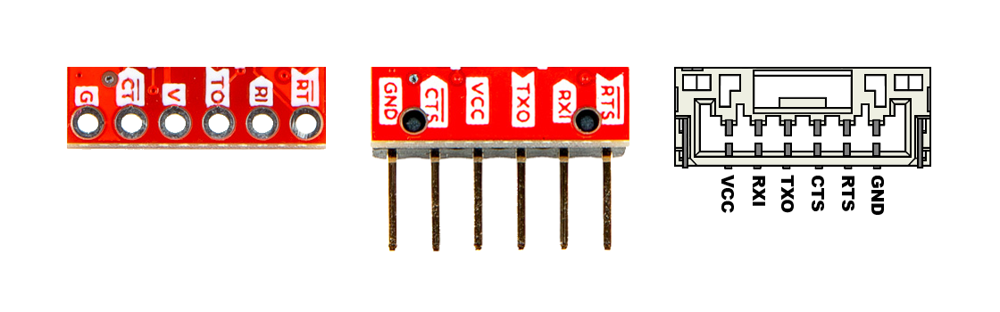
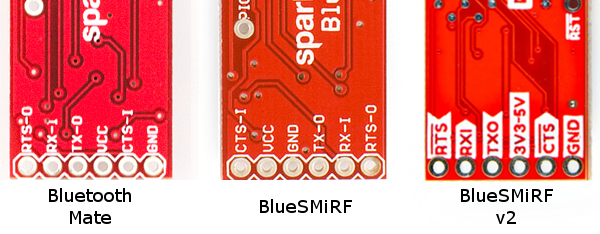

<article style="text-align: center;" markdown>
{ width="650px" }
</article>

# Quick Start Guide

--8<-- "./docs/hardware-overview.md::14"

## Board Layout
The SparkFun BlueSMiRF v2 features the following:

--8<-- "./docs/hardware-overview.md:26:29"

- **ESP32 Module**
:   Espressif's ESP32-PICO-MINI-02 module

- ++"PAIR"++ **Button**
:   A multi-use button used to changes between the various [modes of operation](device-operation.md).

- **Status LEDs**
:   The green `CONNECT` and red `STATUS` LEDs are used to indicate various [modes of operation](hardware-overview.md#leds).

- [**Hardware Connection**](#pin-connections)
:   This connection breaks out the pins for the UART interface and power supply for the BlueSMiRF. Additionally, the three variants provide different options for connecting the BlueSMiRF to their project.

??? info "Board Variants"
	<!-- Import the component -->
	

	

	-   **PTH Pads**
		<model-viewer src="../assets/3d_model/web_model-pth.glb" poster="../assets/3d_model/poster-pth.png" camera-controls tone-mapping="neutral" poster="poster.webp" shadow-intensity="1" exposure="1" camera-orbit="0deg 60deg 0.09m" field-of-view="30deg" style="width: 100%; height: 450px;">
		</model-viewer>

	-   **Male Header Pins**
		<model-viewer src="../assets/3d_model/web_model-smd.glb" poster="../assets/3d_model/poster-smd.png" camera-controls tone-mapping="neutral" poster="poster.webp" shadow-intensity="1" exposure="1" camera-orbit="0deg 60deg 0.09m" field-of-view="30deg" style="width: 100%; height: 450px;">
		</model-viewer>

	-   **JST-GH Connector**
		<model-viewer src="../assets/3d_model/web_model-jst.glb" poster="../assets/3d_model/poster-jst.png" camera-controls tone-mapping="neutral" poster="poster.webp" shadow-intensity="1" exposure="1" camera-orbit="0deg 60deg 0.09m" field-of-view="30deg" style="width: 100%; height: 450px;">
		</model-viewer>

	

	???+ tip "Manipulate 3D Model"
		<article style="text-align: center;" markdown>

		| Controls	   | Mouse					| Touchscreen	|
		| :------------- | :----------------------: | :------------: |
		| Zoom		   | Scroll Wheel			 | 2-Finger Pinch |
		| Rotate		 | ++"Left-Click"++ & Drag  | 1-Finger Drag  |
		| Move/Translate | ++"Right-Click"++ & Drag | 2-Finger Drag  |

		</article>

### Pin Connections
Each variant of the BlueSMiRF v2, has a different connector. The pin layout for these connections, are summarized in the table below.

<figure markdown>
[{ width="500" }](./assets/img/hookup_guide/pins.png "Click to enlarge")
<figcaption markdown>The pin connections on the BlueSMiRF v2.</figcaption>
</figure>

<article style="text-align: center;" markdown>

<table border="1" markdown>
<tr markdown>
<th style="vertical-align:middle;">Label</th>
<td style="text-align:center; vertical-align:middle;" markdown>
	`V` 
	`VCC`
</td>
<td style="text-align:center; vertical-align:middle;" markdown>
	`RI` 
	`RXI`
</td>
<td style="text-align:center; vertical-align:middle;" markdown>
	`TO` 
	`TXO`
</td>
<td style="text-align:center; vertical-align:middle;" markdown>
	`CT` 
	`CTS`
</td>
<td style="text-align:center; vertical-align:middle;" markdown>
	`RT` 
	`RTS`
</td>
<td style="text-align:center; vertical-align:middle;" markdown>
	`GND`
</td>
</tr>
<tr markdown>
<th style="vertical-align:middle;">Function</th>
<td style="text-align:center; vertical-align:middle;" markdown>
	<u>Voltage Input</u> 
	*3.3 to 6.0V*
</td>
<td style="text-align:center; vertical-align:middle;">UART - Receive</td>
<td style="text-align:center; vertical-align:middle;">UART - Transmit</td>
<td style="text-align:center; vertical-align:middle;" markdown>
	Flow Control 
	*Clear-to-Send*
</td>
<td style="text-align:center; vertical-align:middle;" markdown>
	Flow Control 
	*Ready-to-Send*
</td>
<td style="text-align:center; vertical-align:middle;">Ground</td>
</tr>
</table>

</article>

!!! warning "Backwards Compatibility"
	The pin layout of the BlueSMiRF v2 variants with the [PTH pads](https://www.sparkfun.com/sparkfun-bluesmirf-v2.html) and [male header pins](https://www.sparkfun.com/sparkfun-bluesmirf-v2-headers.html), will only be backwards compatible with previous versions of the [BlueSMiRF Mate](revision_history.md#mate-header), as shown in the image below.

	<figure markdown>
	[{ width="600" }](./assets/img/hookup_guide/revision-pinout-all.jpg "Click to enlarge")
	<figcaption markdown>Pin compatibility of different generations of the BlueSMiRF.</figcaption>
	</figure>

## Device Operation

### Create a Serial Link
--8<-- "./docs/device-operation.md:23:39"

### Configure Settings
--8<-- "./docs/device-configuration.md:7:11"

Below is a short list of [AT-commands](device-configuration.md#at-commands) and parameters that are commonly used:

| AT Command           | Command Description                             |
| :------------------: | :---------------------------------------------- |
| `$$$`                | Enter Command Mode - *Hardware connection*      |
| `+++`                | Enter Command Mode - *Bluetooth connection*     |
| `AT?`                | Display this help text                          |
| `ATF`                | Restore factory settings                        |
| `ATP`                | Start pairing process                           |
| `ATW`                | Save current settings to NVM                    |
| `ATX`                | Exit command mode                               |
| `ATZ`                | Reboot the system                               |
| `AT-<Param>=<value>` | Set parameter's value to xxx by name (Param)    |

| AT Command         | Command Description                                  | Factory Default Value |
| :----------------: | :--------------------------------------------------- | :-------------------: |
| `AT-SerialSpeed`   | The baud rate that the BlueSMiRF operates at.        | 115200                |
| `AT-WiFiPassword`  | Password for the SSID, used for over-the-air-updates |                       |
| `AT-WiFiSSID`      | SSID used for over-the-air-updates                   |                       |

#### Restore Factory Defaults
There are two methods to restore the device's settings to their factory defaults.

1. Access the command mode, then use the `ATF` and `ATW` AT-commands to restore and save all the settings to their factory defaults.
1. Hold the ++"PAIR"++ button down for more than 8 seconds, until the `STATUS` and `CONNECT` LEDs to quickly blink back and forth. When the button is released, all the settings will be restored to their factory defaults.

	--8<-- "./docs/device-operation.md:104:107"

### Firmware Update
Because it's much easier to use, we recommend the OTA firmware update process.

--8<-- "./docs/firmware-overview.md:68:131"
