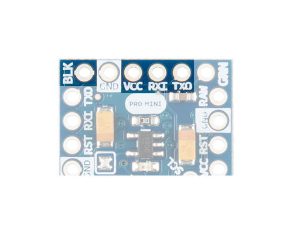
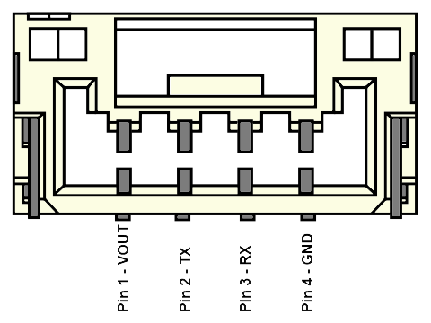
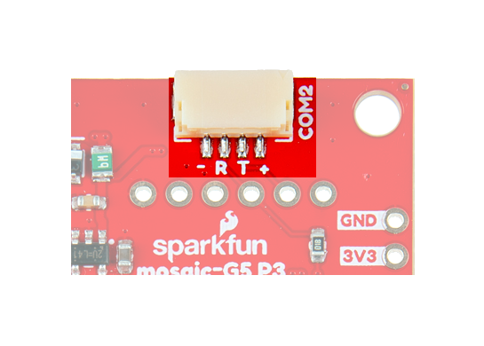
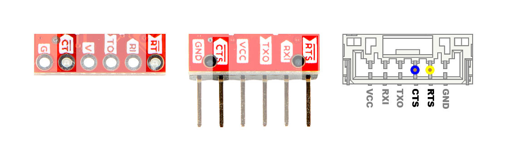
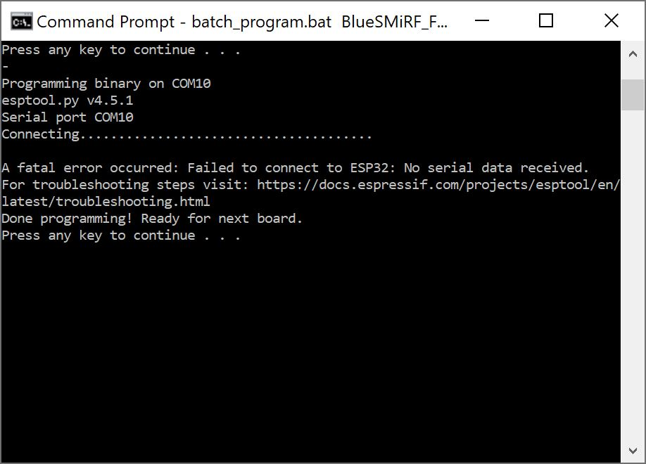

!!! warning "Need Help?"
	If you need technical assistance or more information on a product that is not working as you expected, we recommend heading on over to the [SparkFun Forums](https://community.sparkfun.com).


	!!! info "Account Registration Required"
		If this is your first visit to our forum, you'll need to create a [Forum Account](https://community.sparkfun.com/signup) to post questions.


## FAQ
- Can the BlueSMiRF v2 be used to program another Arduino board through its serial interface?
	- No, we recommend removing the BlueSMiRF v2 and using a USB-to-serial adapter instead
- Can the BlueSMiRF v2 be used to update the firmware of a GNSS module on our breakout boards?
	- No, we recommend using a USB-to-serial adapter instead


## Device Compatibility
To be directly compatible with the BlueSMiRF v2, devices need the hardware connections listed below. Otherwise, our [JST pigtail cables](https://www.sparkfun.com/breadboard-to-jst-ghr-06v-cable-6-pin-x-1-25mm-pitch-for-loraserial.html) and jumper wires provide more flexibility for devices with a proper power supply, logic-levels, and a UART interface.


### BlueSMiRF/Serial Interface Pins
To connect the BlueSMiRF v2 directly, a compatible device needs to have a 0.1" spaced header, with a pin layout of `GND`/`NC`/`VCC`/`TX`/`RX`/`NC`:


<figure markdown>
[{ width="400" }](./assets/img/hookup_guide/connection-pth-serial.png "Click to enlarge")
<figcaption markdown>Compatible pin layout for a direct header connection.</figcaption>
</figure>


### JST Cables
To utilize our [4-pin to 6-pin JST-GH cables](https://www.sparkfun.com/jst-ghr-04v-to-jst-ghr-06v-cable-1-25mm-pitch.html), a compatible device needs to have a 4-pin JST connector with a pin layout of `VCC`/`TX`/`RX`/`GND`, from left-to-right, as viewed looking into the connector:


<div class="grid" markdown>

<figure markdown>
[{ width="400" }](./assets/img/hookup_guide/connection-jst-4.png "Click to enlarge")
<figcaption markdown>Pin layout for the 4-pin JST connector.</figcaption>
</figure>


<figure markdown>
[{ width="400" }](./assets/img/hookup_guide/connection-jst-gnss.png "Click to enlarge")
<figcaption markdown>The JST connection on compatible GNSS boards.</figcaption>
</figure>

</div>


## Flow Control Pins
Only connect **3.3V** signals to the flow control pins of the UART interface; there is no logic-level conversion for these pins. When utilizing a UART-to-USB adapter with flow-control enabled, the `RTS` and `CTS` pins should be connected between the two devices.


<figure markdown>
[{ width="600" }](./assets/img/hookup_guide/pins-flow_control.png "Click to enlarge")
<figcaption markdown>The UART flow control pins on the BlueSMiRF v2.</figcaption>
</figure>


## Reprogramming the BlueSMiRF v2
If you are seeing the following error when attempting to manually reprogram the firmware:


??? terminal "Error Message"
	```sh
	A fatal error occurred: Failed to connect to ESP32: No serial data received. For troubleshooting steps visit: https://docs.espressif.com/projects/esptool/en/latest/troubleshooting.md_in_html
	Done programming! Ready for next board.
	Press any key to continue . . .
	```


<div class="grid" markdown>


<figure markdown>
[{ width="600" }](./assets/img/hookup_guide/firmware-upload_failed.jpg "Click to enlarge")
<figcaption markdown>Error Programming BlueSMiRF v2 - ESP32</figcaption>
</figure>


<div markdown>

Double-Check:

- The wires are making connection and not loose
- The wiring for USB-to-Serial Converter is connected properly the BlueSMiRF v2
- The proper COM port is utilized for the USB-to-Serial converter, as enumerated to on your computer
- The appropriate USB drivers ar installed for the USB-to-Serial converter
- The BlueSMiRF v2 is in Bootloader mode

Still having issues? Try a power cycle by following the steps below:

1. Disconnect the USB-to-serial converter from your computer
1. Hold down on the ++"PAIR"++ button, to force the BlueSMiRF v2 into bootloader mode
1. While holding the ++"PAIR"++ button, reconnect the USB-to-serial converter back to your computer
1. Release the ++"PAIR"++ button

</div>

</div>


### Baud Rate
Some users have reported issues, where the `921600` baud rate does not work. If you encounter this problem, reduce the baud rate to `115200`.
